# 🚀 HƯỚNG DẪN DỰ ÁN CHO THÀNH VIÊN MỚI (ONBOARDING GUIDE)
### Hệ thống Giám sát SOP Thời Gian Thực Bằng Thị Giác Máy Tính — AI Monitoring Hub

> **Phiên bản tài liệu:** Tháng 11/2026  
> **Người biên soạn:** Nhóm phát triển AI Hub (HTMP Factory)

---

## 📌 MỤC LỤC NHANH
1. [Dự Án Này Là Gì & Giải Quyết Vấn Đề Gì?](#1-dự-án-này-là-gì--giải-quyết-vấn-đề-gì)
2. [Hiện Trạng Triển Khai & Phân Chia Công Việc](#2-hiện-trạng-triển-khai--phân-chia-công-việc)
3. [Nhiệm Vụ Trọng Tâm Cần Phối Hợp Ngay (Máy 8 - Lắp 8 Ốc)](#3-nhiệm-vụ-trọng-tâm-cần-phối-hợp-ngay-máy-8---lắp-8-ốc)
4. [Ràng Buộc Kỹ Thuật & Phần Cứng Sống Còn (BẮT BUỘC NHỚ)](#4-ràng-buộc-kỹ-thuật--phần-cứng-sống-còn-bắt-buộc-nhớ)
5. [Kiến Trúc Hệ Thống & Luồng Dữ Liệu (Pipeline)](#5-kiến-trúc-hệ-thống--luồng-dữ-liệu-pipeline)
6. [Bản Đồ Thư Mục & Các File Quan Trọng](#6-bản-đồ-thư-mục--các-file-quan-trọng)
7. [Hướng Dẫn Cài Đặt & Chạy Thử Lần Đầu (5 Phút)](#7-hướng-dẫn-cài-đặt--chạy-thử-lần-đầu-5-phút)
8. [Bộ Công Cụ Hỗ Trợ Phát Triển Sẵn Có (Tools)](#8-bộ-công-cụ-hỗ-trợ-phát-triển-sẵn-có-tools)
9. [Quy Tắc Làm Việc Nhóm & Quy Chuẩn Mã Nguồn](#9-quy-tắc-làm-việc-nhóm--quy-chuẩn-mã-nguồn)
10. [Lộ Trình 3 Ngày Đầu Tiên Của Bạn](#10-lộ-trình-3-ngày-đầu-tiên-của-bạn)

---

## 1. Dự Án Này Là Gì & Giải Quyết Vấn Đề Gì?

### 🎯 Bối cảnh thực tế tại nhà máy
Tại các xưởng sản xuất cơ khí chính xác và ép nhựa của HTMP, công nhân vận hành theo các quy trình chuẩn gọi là **SOP (Standard Operating Procedure)**:
- Thao tác dập chi tiết, kiểm tra bavia, xếp vào khay, bấm nút an toàn.
- Lắp ráp linh kiện (bắt ốc, lắp gioăng cao su, gắn nắp nẹp...).

### ⚠️ Rủi ro nếu không có AI giám sát
- **Bỏ sót bước / Thiếu linh kiện:** Quên bắt 1–2 con ốc nhưng đã đóng nắp và xuất hàng $\rightarrow$ Lọt sản phẩm NG (Not Good) tới khách hàng, thiệt hại uy tín và chi phí đền bù.
- **Sai quy trình thao tác an toàn:** Công nhân đưa tay vào vùng nguy hiểm khi khuôn máy đang chạy $\rightarrow$ Tai nạn lao động hoặc hỏng khuôn cơ khí tiền tỷ.
- **Năng suất không đồng đều:** Không có dữ liệu khách quan để đo đếm thời gian chu kỳ (cycle time), tỷ lệ tuân thủ và tình trạng dừng máy (downtime).

### 💡 Giải pháp: AI Monitoring Hub
Hệ thống sử dụng **Camera IP (RTSP)** gắn trực tiếp tại từng trạm máy:
1. **Phát hiện theo thời gian thực:** Dùng mô hình YOLO nhận diện bàn tay công nhân, phôi kim loại/nhựa, phụ kiện (ốc vít, nẹp).
2. **Kiểm soát logic SOP:** Đánh giá vị trí tương đối giữa tay và các vùng làm việc (ROI/Zones), theo dõi trình tự trạng thái (FSM) hoặc tích lũy bằng chứng thao tác.
3. **Phản hồi tức thì 3 tầng:**
   - 🔊 **Âm thanh:** Phát còi cảnh báo ngay tại chỗ qua loa trạm khi công nhân làm sai/thiếu bước.
   - 📹 **Bằng chứng:** Tự động cắt và lưu clip video ngắn (10s trước + 5s sau lỗi) định dạng MP4 H.264.
   - 📊 **Web Dashboard:** Hiển thị luồng trực tiếp, trạng thái bước, tỷ lệ tuân thủ, lịch sử vi phạm cập nhật tức thời qua WebSocket.

---

## 2. Hiện Trạng Triển Khai & Phân Chia Công Việc

Dự án áp dụng triết lý **"Work Per Machine"** (Mỗi người làm chủ trọn vẹn 1–2 máy từ khâu khảo sát camera, viết logic engine, đến kiểm thử thực tế).

### 🏭 Danh sách các máy trong hệ thống:

| Máy / Station ID | Mã Sản Phẩm | Loại Thao Tác | YOLO Model | Trạng thái hiện tại | Phụ trách |
| :--- | :--- | :--- | :--- | :--- | :--- |
| **Máy 4** (`machine_04`) | `639957` | Dập / Ép nhựa | `639957.onnx` | Đang vận hành ổn định | Duy trì chung |
| **Máy 6** (`machine_06`) | `TNA2269` | Dập khuôn | `TNA2269.onnx` | Đang vận hành ổn định | Duy trì chung |
| **Máy 7** (`machine_07`) | `TFF4040`, `626287` | Dập 2 chi tiết | `TFF4040_FINAL2.onnx` | Đang vận hành chuẩn mẫu | **Mình phụ trách** |
| **Máy 8** (`machine_08`) | `laprap` | **Lắp 8 ốc trắng** | Đang nâng cấp v2 | **Nhiệm vụ trọng tâm của bạn & mình** | **Bạn + Mình hỗ trợ** |
| **Máy 9** (`machine_09`) | `KOR-H2110` | Dập khuôn | `KOR-H2110.onnx` | Đang vận hành ổn định | Duy trì chung |

### 🤝 Phân định ranh giới phối hợp giữa 2 người:
- **Phần mình phụ trách chính:**
  - Kiến trúc Hub trung tâm (`main.py`, `app/routes.py`, Web Dashboard SPA, Socket.IO).
  - Tầng dữ liệu & Database Schema (`shared/db/`, MySQL pool).
  - Duy trì logic Máy 7 (`TFF4040_engine.py`) làm code mẫu chuẩn (Reference Engine).
  - Hỗ trợ bạn làm quen môi trường, trích xuất dữ liệu, review logic và chạy thực tế.
- **Phần bạn phụ trách trọng tâm:**
  - Làm chủ bài toán **Trạm Máy 8 (Lắp ráp 8 con ốc trắng)**.
  - Xây dựng Engine mới (`laprap_engine_v2.py`) và huấn luyện/tối ưu mô hình nhận diện ốc.
  - Phối hợp hoàn thiện khung **Distributed Edge Client** (`edge_client/`) để chạy AI trực tiếp trên máy tính trạm con.

---

## 3. Nhiệm Vụ Trọng Tâm Cần Phối Hợp Ngay (Máy 8 - Lắp 8 Ốc)

> 📄 **Tài liệu chi tiết:** Đọc ngay file [ke_hoach_trien_khai_laprap_8_oc.md](file:///C:/Users/it07/Downloads/AI_Monitoring_Hub/ke_hoach_trien_khai_laprap_8_oc.md) ở thư mục gốc.

### Thách thức kỹ thuật tại Máy 8
Trạm Máy 8 là trạm lắp ráp thủ công với độ khó cao hơn các máy dập thông thường:
1. **Thao tác 3D tự do:** Công nhân cầm chi tiết xoay ngang, xoay dọc, dốc ngược, không bắt buộc theo thứ tự cố định.
2. **Nhiều sản phẩm trong khung hình:** Dưới khay nhựa có sẵn 4–5 sản phẩm tĩnh nằm ngang, camera chiếu từ trên xuống dễ bị nhầm sản phẩm trên tay với sản phẩm dưới khay.
3. **Bao ngón tay màu trắng:** Công nhân đeo bọc ngón tay cao su trắng, dễ gây dương tính giả (False Positive) với hạt ốc màu trắng.

### Giải pháp kỹ thuật 4 giai đoạn chúng ta sẽ triển khai:
```
[Frame Video 20 FPS]
      │
      ▼
Giai đoạn 1: Lọc Không Gian & Tách Động/Tĩnh
      ├─ Bộ lọc Góc xoay Bbox (Chi tiết đang làm xoay dọc/chéo 45°-90°, đáy khay nằm ngang 0°)
      ├─ Bộ lọc Chuyển động MOG2 (Loại bỏ các sản phẩm bất động ở đáy khay)
      └─ Khóa Bbox giao cắt với bàn tay công nhân (ByteTrack / CSRT)
      │
      ▼
Giai đoạn 2: Tích Lũy Bằng Chứng 8 Vị Trí Ốc (Temporal Slot Accumulator)
      ├─ Chia thân sản phẩm thành 8 Slot tương đối
      └─ Tích lũy theo thời gian: Slot[i] = True khi công nhân xoay chi tiết để lộ đốm ốc
      │
      ▼
Giai đoạn 3: Bắt Trigger Tự Nhiên Chốt Chu Kỳ
      └─ Bắt hành vi công nhân lấy thanh nẹp đen (Cover) từ khay trái ốp vào thân chi tiết
      │
      ▼
Giai đoạn 4: Đánh Giá & Ra Quyết Định
      ├─ Nếu sum(Slots) == 8  ==> PASS ✅ (Ghi nhận chu kỳ thành công vào DB)
      └─ Nếu sum(Slots) < 8   ==> NG 🚨 (Hú còi cảnh báo ngay + Lưu video clip vi phạm)
```

**Video test có sẵn:** `data/recordings/laprap_20261103_131237_10min.mp4` (Video thực tế dài 10 phút, đầy đủ tình huống lắp ráp).

---

## 4. Ràng Buộc Kỹ Thuật & Phần Cứng Sống Còn (BẮT BUỘC NHỚ)

> [!CAUTION]
> **SERVER HIỆN TẠI KHÔNG CÓ GPU RỜI (NO GPU).**  
> Máy chủ trung tâm là chip **Intel Xeon Silver 4510** (12 Cores / 24 Threads, 256 GB RAM).

Mọi quyết định lập trình AI của dự án đều phải phục vụ ràng buộc này:
1. **Chỉ dùng ONNX Runtime CPU:** Tuyệt đối không import PyTorch CUDA trong vòng lặp xử lý frame (`processor.py`).
2. **InferenceEngine Singleton:** Tất cả camera khi chạy Full mode trên Hub đều dùng chung 1 engine inference duy nhất với khóa `threading.Lock()` tuần tự (`shared/inference_engine.py`).
3. **Kiểm soát CPU Threads triệt để:**
   ```python
   # Đã được khóa cứng ở đầu main.py
   cv2.setNumThreads(0)
   os.environ["OMP_NUM_THREADS"] = "1"
   os.environ["MKL_NUM_THREADS"] = "1"
   os.environ["OMP_WAIT_POLICY"] = "PASSIVE"
   ```
4. **Skip Frame thông minh:** Camera stream 15–20 FPS, nhưng module AI chỉ cần quét mỗi 2 frame một lần (~7.5 FPS). Kết quả tay được cache lại ở frame kế tiếp. Cách làm này giảm 50% tải CPU mà mắt thường không phát hiện độ trễ.
5. **Kích thước ảnh inference:** Chuẩn hóa về **416x416** hoặc **640x480** trước khi đưa vào mô hình.

---

## 5. Kiến Trúc Hệ Thống & Luồng Dữ Liệu (Pipeline)

### 5.1. Hai chế độ vận hành (Hub Modes)

Hệ thống hỗ trợ 2 chế độ cấu hình trong `config/config.yaml`:

```mermaid
graph TD
    subgraph Mode_Full["Mode 1: FULL (AI chạy tại Hub)"]
        Cam1["Camera IP"] -->|RTSP| Hub1["Hub Server (Intel Xeon)"]
        Hub1 --> AI1["YOLO ONNX CPU + SOP Engine"]
        AI1 --> Web1["Web Dashboard :5001"]
    end

    subgraph Mode_Aggregator["Mode 2: AGGREGATOR / DISTRIBUTED (Khuyến nghị Production)"]
        Cam2["Camera IP"] -->|RTSP| Edge["Mini-PC tại máy (Edge Client)"]
        Edge --> AI2["YOLO Local + Engine"]
        AI2 -->|HTTP POST Frame + Events| Hub2["Hub Server (Chỉ hiển thị & Lưu DB)"]
        Hub2 --> Web2["Web Dashboard :5001"]
    end
```



- **Full Mode (`hub.mode: "full"`):** Phù hợp test nhanh, chạy 1–3 camera.
- **Aggregator Mode (`hub.mode: "aggregator"`):** Trạm con (Máy 8) tự chạy AI trên Mini-PC, chỉ bắn frame JPEG và event vi phạm về Hub qua HTTP API. CPU Hub gần như bằng 0%.

### 5.2. Luồng xử lý chi tiết của 1 Frame Video (Pipeline)

```
[RTSP Stream (rtsp_manager.py)]
      │ (Tự động reconnect nếu rớt mạng, resize về 640x480)
      ▼
[FrameRingBuffer (buffer.py)]  <--- Đệm liên tục 15-20s video trong RAM (deque)
      │
      ▼
[HandDetector / YOLO ONNX (hand_detector.py)]
      │ (Trả về Bounding Boxes: hand, sp, robot)
      ▼
[Dynamic ROI & Associate Hands (processor.py)]
      │ (Lọc tay ngoài vùng làm việc, định danh tay Trái / Phải)
      ▼
[ProductEngine (core/engines/<product>_engine.py)]
      │ (Kiểm tra trạng thái SOP: FSM / Slot Accumulator)
      ▼
[ViolationDetector (violation_detector.py)]
      │ (Xác định lỗi: Bỏ bước, sai thứ tự, thiếu ốc, thao tác quá thời gian)
      ▼
 ┌────┴──────────────────────────┬─────────────────────────────┐
 ▼                               ▼                             ▼
[AudioAlert]                [ClipSaver]               [Database & SocketIO]
Phát còi .wav qua loa      Cắt RingBuffer xuất file   Ghi DB `sop_events` và
trạm (sounddevice)         MP4 (imageio-ffmpeg)       đẩy realtime lên Dashboard
```

---

## 6. Bản Đồ Thư Mục & Các File Quan Trọng

```
AI_Monitoring_Hub/
├── app/                                # Web Application (Flask + Flask-SocketIO)
│   ├── routes.py                       # REST APIs, luồng MJPEG generator, webhook nhận frame Edge
│   ├── templates/                      # Giao diện HTML (portal.html, index.html, station.html, history.html, stats.html)
│   └── static/                         # CSS, JS, hình ảnh minh họa trạm máy
├── config/
│   └── config.yaml                     # File cấu hình trung tâm (Cực kỳ quan trọng)
├── core/                               # Logic cốt lõi dùng cho chế độ rút gọn / testing
├── data/                               # Dữ liệu runtime (Không commit lên Git)
│   ├── logs/                           # System logs (xoay vòng 30 ngày)
│   ├── recordings/                     # Video mẫu thực tế từ nhà máy (dùng test offline)
│   └── violations/                     # Video clip các vụ vi phạm được lưu tự động (.mp4)
├── docs/                               # Toàn bộ tài liệu chi tiết của dự án
│   ├── ONBOARDING/                     # Bộ 9 bài hướng dẫn sâu từng khía cạnh (00 -> 09)
│   └── machines/                       # Ghi chép đặc thù của từng trạm máy
├── edge_client/                        # Source code chạy trên Mini-PC độc lập tại trạm
│   ├── main.py                         # Client đẩy frame và kết quả về Hub
│   └── config.yaml.example
├── projects/sop_monitoring/            # TRÁI TIM XỬ LÝ AI & SOP
│   ├── config/                         # Cấu hình vùng ROI và các bước SOP từng mã hàng (*.yaml)
│   │   ├── 626287.yaml
│   │   ├── TFF4040.yaml
│   │   └── laprap.yaml                 # Cấu hình trạm lắp ráp Máy 8
│   ├── core/
│   │   ├── engines/                    # Nơi chứa code logic kiểm tra SOP của từng sản phẩm
│   │   │   ├── base_engine.py          # Lớp trừu tượng BaseEngine (Mọi engine phải kế thừa)
│   │   │   ├── loader.py               # Cơ chế nạp động class engine theo tên mã hàng
│   │   │   ├── TFF4040_engine.py       # Code mẫu hoàn chỉnh nhất của Máy 7 (NÊN ĐỌC KỸ)
│   │   │   └── laprap_engine.py        # Engine hiện tại của Máy 8 (Sắp nâng cấp v2)
│   │   ├── spatial_engine.py           # Thuật toán kiểm tra điểm/box nằm trong Polygon
│   │   ├── tracking_engine.py          # Bộ bám vết tay và lọc rung nhiễu
│   │   └── violation_detector.py       # Bộ phát hiện và phân loại vi phạm
│   ├── buffer.py                       # Bộ đệm vòng FrameRingBuffer lưu video trước/sau sự cố
│   ├── hand_detector.py                # Wrapper gọi YOLO ONNX inference
│   └── processor.py                    # Nhạc trưởng điều phối luồng FrameProcessor
├── shared/                             # Các thư viện dùng chung toàn hệ thống
│   ├── db/                             # Tầng kết nối MySQL (Pool PooledDB) & câu lệnh Query
│   ├── events/                         # Xử lý âm thanh cảnh báo (AudioAlert) & lưu video (ClipSaver)
│   ├── models/yolo/                    # Chứa toàn bộ các file model AI (*.onnx)
│   ├── services/                       # Logger, ConfigLoader, DiskMonitor, Annotator vẽ box
│   └── tools/                          # Bộ công cụ cực hữu ích (Vẽ zone, cắt ảnh, extract frame)
├── .env                                # Biến môi trường (DB password, Port, đường dẫn)
├── main.py                             # Điểm khởi chạy chính của toàn bộ hệ thống
├── requirements.txt                    # Thư viện phụ thuộc
├── ONBOARDING.md                       # File tài liệu bạn đang đọc
└── ke_hoach_trien_khai_laprap_8_oc.md  # Kế hoạch chi tiết nâng cấp trạm lắp ráp 8 ốc Máy 8
```

---

## 7. Hướng Dẫn Cài Đặt & Chạy Thử Lần Đầu (5 Phút)

### Bước 1: Chuẩn bị môi trường Python
- Yêu cầu: **Python 3.10 hoặc 3.11** (Tránh dùng Python 3.13 vì một số thư viện ONNX/C++ chưa tương thích).
- Khởi tạo môi trường ảo (Virtualenv):
  ```bash
  python -m venv .venv
  # Trên Windows:
  .venv\Scripts\activate
  ```

### Bước 2: Cài đặt các thư viện
```bash
pip install -r requirements.txt
```

### Bước 3: Cấu hình file `.env`
Tạo file `.env` tại thư mục gốc (hoặc kiểm tra file `.env` đã có sẵn):
```env
# --- App Server ---
APP_HOST=0.0.0.0
APP_PORT=5001

# --- Paths ---
CONFIG_PATH=config/config.yaml
SOP_DEFINITIONS_DIR=projects/sop_monitoring/config
VIOLATIONS_DIR=data/violations
LOGS_DIR=data/logs

# --- CPU Optimization ---
AI_MAX_THREADS=4
AI_FPS_CAP=15
AI_INPUT_SIZE=416

# --- Database (Đã trỏ vào máy chủ DB nội bộ) ---
DB_HOST=10.0.10.13
DB_PORT=3306
DB_USER=minhha
DB_PASSWORD=Htmp1234
DB_NAME=ai_system
```
*(Nếu làm việc offline hoặc không có mạng nội bộ, hệ thống sẽ tự động bật cờ cảnh báo và chạy bình thường mà không ghi DB).*

### Bước 4: Chạy thử nghiệm hệ thống
Chạy lệnh khởi động chính:
```bash
python main.py
```
Sau khi terminal báo `DASHBOARD IS READY AT: http://0.0.0.0:5001`, mở trình duyệt web truy cập:
- **Trang chủ chọn trạm:** `http://localhost:5001/`
- **Dashboard lưới camera SOP:** `http://localhost:5001/sop`
- **Chi tiết trạm Máy 7:** `http://localhost:5001/station/machine_07`

### 💡 Mẹo cực hay: Chạy test Offline bằng file Video
Bạn không cần phải có camera IP thật để phát triển! Hãy tráo `rtsp_url` trong `config/config.yaml` bằng đường dẫn file video có sẵn:
```yaml
# Trong config/config.yaml -> camera machine_08:
rtsp_url: "data/recordings/laprap_20261103_131237_10min.mp4"
```
Hệ thống sẽ tự động đọc file video giả lập như một luồng RTSP camera thật với tốc độ chuẩn FPS!

---

## 8. Bộ Công Cụ Hỗ Trợ Phát Triển Sẵn Có (Tools)

Đừng viết lại bánh xe! Trong thư mục `shared/tools/` đã có đầy đủ các công cụ phục vụ quy trình làm việc với camera:

1. **Chụp ảnh mẫu từ Camera (`shared/tools/capture_snapshot.py`):**
   - Kết nối vào RTSP camera và lưu 1 ảnh tĩnh rõ nét để phục vụ vẽ vùng làm việc.
2. **Công cụ định nghĩa vùng làm việc (`shared/tools/zone_selector.py`):**
   - Giao diện đồ họa (GUI) cho phép dùng chuột chấm các đỉnh của đa giác (Polygon).
   - Tự động chuẩn hóa tọa độ về dải `[0..1]` và in ra đoạn YAML sẵn sàng dán vào file config sản phẩm.
3. **Trích xuất khung hình tự động (`shared/tools/frame_extractor.py` & `scripts/extract_frames.py`):**
   - Cắt video ghi hình thành các ảnh JPG riêng biệt để gán nhãn dữ liệu (Labeling Roboflow/YOLO).
4. **Ghi hình luồng RTSP (`shared/tools/record_video.py`):**
   - Lưu lại 10–15 phút thao tác của công nhân tại trạm để mang về làm tập dữ liệu kiểm thử.

---

## 9. Quy Tắc Làm Việc Nhóm & Quy Chuẩn Mã Nguồn

Để hai người phối hợp mượt mà, không giẫm chân lên nhau và không làm gãy hệ thống đang chạy ở nhà máy, chúng ta thống nhất 5 nguyên tắc vàng:

### 1. Không sửa file Engine của người khác
- File của Máy 7 là `projects/sop_monitoring/core/engines/TFF4040_engine.py` (Mình quản lý).
- Khi phát triển bài toán 8 ốc cho Máy 8, bạn hãy tạo file mới:  
  `projects/sop_monitoring/core/engines/laprap_engine_v2.py`.  
  Sau đó chỉ cần đổi `engine_id: "laprap_v2"` trong `config/config.yaml`.

### 2. Mọi Engine bắt buộc kế thừa `BaseEngine`
Xem [base_engine.py](file:///C:/Users/it07/Downloads/AI_Monitoring_Hub/projects/sop_monitoring/core/engines/base_engine.py). Class của bạn phải là:
```python
from projects.sop_monitoring.core.engines.base_engine import BaseEngine

class ProductEngine(BaseEngine):
    def __init__(self, config: dict):
        super().__init__(config)
        ...
    def update(self, hands_data, products_data=None, robot_data=None):
        # Trả về dict chứa sop_status, progress_percent, current_step,...
        ...
```
`EngineLoader` sẽ tự động tìm kiếm class `ProductEngine` trong file để nạp vào hệ thống.

### 3. Quy chuẩn Git & Branch
- Nhánh `main`: Nhánh ổn định, đang chạy trên server nhà máy.
- Nhánh phát triển Máy 8: Tạo nhánh `feature/laprap-8-screws-v2`.
- Khi có tính năng mới hoặc chỉnh sửa xong: Tạo Pull Request để hai bên cùng review chéo trước khi merge vào `main`.

### 4. Giữ gìn tài nguyên CPU
- Không thêm vòng lặp lồng nhau phức tạp không cần thiết trong hàm `update()` của Engine.
- Tránh cấp phát bộ nhớ mảng lớn (`np.zeros`) lặp đi lặp lại trong mỗi frame; hãy khởi tạo sẵn trong `__init__`.

---

## 10. Lộ Trình 3 Ngày Đầu Tiên Của Bạn

Để bạn bắt nhịp thoải mái và đạt hiệu quả cao nhất:

### 📅 Ngày 1: Nắm bắt kiến trúc & Dựng môi trường
- [ ] Đọc hết tài liệu `ONBOARDING.md` này và lướt qua [ke_hoach_trien_khai_laprap_8_oc.md](file:///C:/Users/it07/Downloads/AI_Monitoring_Hub/ke_hoach_trien_khai_laprap_8_oc.md).
- [ ] Clone repo, tạo `.venv`, cài đặt `requirements.txt`.
- [ ] Chạy thành công `python main.py` trên máy cá nhân, mở Dashboard `http://localhost:5001/sop`.
- [ ] Thử đổi `rtsp_url` của trạm sang file video `data/recordings/laprap_20261103_131237_10min.mp4` để xem video chạy trên web.

### 📅 Ngày 2: Đọc mã nguồn mẫu & Khảo sát bài toán Máy 8
- [ ] Đọc file [TFF4040_engine.py](file:///C:/Users/it07/Downloads/AI_Monitoring_Hub/projects/sop_monitoring/core/engines/TFF4040_engine.py) để hiểu cách tổ chức máy trạng thái (FSM) và xử lý tương tác vùng.
- [ ] Xem trọn vẹn 10 phút video Máy 8 `laprap_20261103_131237_10min.mp4`. Quan sát:
  - Vị trí khay đựng sản phẩm đen bên phải.
  - Vị trí khay đựng nẹp đen bên trái.
  - Cách công nhân cầm chi tiết xoay và cách họ ốp nẹp đen chốt chu kỳ.
- [ ] Trao đổi với mình về các điểm bạn nhận xét được từ video.

### 📅 Ngày 3: Bắt tay vào Giai đoạn 1 (Lọc không gian Máy 8)
- [ ] Viết script nhỏ trong `scratch/` hoặc chạy công cụ trích xuất 100 frame đại diện từ video Máy 8.
- [ ] Thử nghiệm thuật toán bóc tách chi tiết trên tay:
  - Thử nghiệm Background Subtraction (MOG2) để loại bỏ phôi tĩnh nằm dưới đáy khay.
  - Thử tính góc nghiêng của chi tiết trên tay.
- [ ] Cùng mình thống nhất cấu trúc của `laprap_engine_v2.py`.

---

## 📞 KÊNH HỖ TRỢ & TRA CỨU
- Khi gặp lỗi hoặc có thắc mắc về luồng code: Hãy hỏi trực tiếp mình, mình sẽ giải thích chi tiết từng dòng.
- Các tài liệu đọc thêm nâng cao khi cần tra cứu:
  - [docs/ONBOARDING/03_CODE_TOUR.md](file:///C:/Users/it07/Downloads/AI_Monitoring_Hub/docs/ONBOARDING/03_CODE_TOUR.md): Đi một vòng chi tiết qua từng hàm số.
  - [docs/ONBOARDING/04_SOP_ENGINE_GUIDE.md](file:///C:/Users/it07/Downloads/AI_Monitoring_Hub/docs/ONBOARDING/04_SOP_ENGINE_GUIDE.md): Cẩm nang thiết kế Engine FSM.
  - [distributed_setup_guide.md](file:///C:/Users/it07/Downloads/AI_Monitoring_Hub/distributed_setup_guide.md): Hướng dẫn kết nối Edge Mini-PC với Hub.

**Chào mừng bạn gia nhập dự án! Chúc hai chúng ta phối hợp thật ăn ý và đưa hệ thống vận hành xuất sắc tại nhà máy!** 🚀

