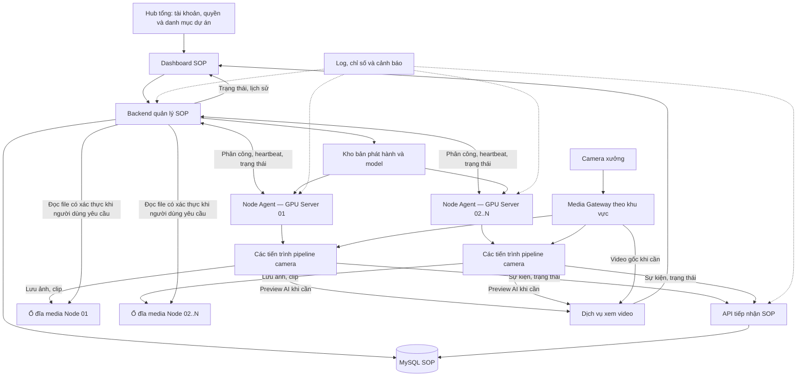

# Kế hoạch kiến trúc phân tán cho dự án AI giám sát thao tác

**Trạng thái:** kế hoạch phát triển, chưa phải hướng dẫn cài đặt các tính năng đã hoàn thiện.

Tài liệu này thay thế hướng dẫn Distributed Edge trước đây và là kế hoạch kiến trúc duy nhất cho việc mở rộng SOP. Phạm vi hiện tại là dự án giám sát thao tác. Hub tổng giữ vai trò quản lý và truy cập dự án; chưa triển khai thêm dự án AI khác.

## 1. Mục tiêu và kiến trúc được chọn

- Hub tổng cung cấp danh mục dự án, tài khoản và quyền truy cập.
- Khi chọn SOP, người dùng vào hệ thống con có backend, dashboard, dữ liệu và các node xử lý riêng.
- SOP hướng đến 100–200 camera bằng cách bổ sung server, đăng ký node và giao camera từ một nơi.
- Mỗi camera được phép có model, engine thao tác, ROI, thứ tự bước, thời gian, ngưỡng và thông số chạy riêng.
- Mỗi camera là một pipeline có ID ổn định, trạng thái nghiệp vụ và bộ phiên bản triển khai riêng.
- Phần mềm được phát hành tập trung; không copy nguyên dự án, sửa cấu hình rồi vận hành một dashboard/DB riêng trên mỗi server.
- Thêm camera, cập nhật hoặc sửa lỗi phải có phạm vi ảnh hưởng rõ ràng và khả năng quay lại phiên bản trước.
- 200 camera là mục tiêu kiểm thử năng lực, không phải cam kết hệ thống mặc nhiên đáp ứng.

**Quyết định:** backend SOP quản lý tập trung + Node Agent trên từng server + tiến trình pipeline camera + Media Gateway theo khu vực + DB SOP tập trung và ảnh/video lưu tại từng server xử lý camera.

## 2. Đánh giá kế hoạch cũ và hiện trạng repository

| Nội dung | Mã hiện có | Quyết định |
|---|---|---|
| Hub tổng và trang SOP | `app/routes.py` có `/` và `/sop`, cùng ứng dụng Flask | Giữ cổng truy cập; tạo ranh giới backend SOP để có thể triển khai độc lập |
| Tách AI khỏi dashboard | `main.py` có `full`, `aggregator`, `is_external` | Tận dụng khi chuyển đổi; chưa phải cơ chế quản lý hay phân công server |
| Model/cấu hình từng camera | `FrameProcessor` nhận `yolo_model`, thông số camera và engine | Giữ khả năng tùy biến; quản lý bằng bản triển khai có phiên bản |
| Tái sử dụng model | `InferenceEngine` giữ instance theo đường dẫn trong cùng tiến trình, khóa theo instance | Là tối ưu nội bộ; chưa phải quản lý GPU giữa nhiều server |
| GPU | `shared/inference_engine.py` chỉ định `CPUExecutionProvider`; requirements có `onnxruntime` | Cần chọn provider, khóa môi trường và xác nhận GPU thực sự chạy trước khi đo năng lực |
| Edge Client | `edge_client/main.py` chạy một camera, có vòng xử lý/vẽ hình riêng | Tái sử dụng thành phần; hợp nhất thành một pipeline nghiệp vụ dùng chung |
| Kết quả Edge | `FramePusher` gửi JPEG/status/hands; `push_frame` lưu cache RAM, phát WebSocket | Chỉ đủ đường preview/trạng thái tạm; phải xây tiếp nhận sự kiện bền vững và lưu clip |
| Phụ thuộc DB/cấu hình | Processor local gọi `EventQueries`, các lớp đọc cấu hình toàn cục | Tách giao diện nhận cấu hình và xuất sự kiện; worker không ghi DB trực tiếp |
| Phân phối phần mềm | `edge_dist` có script đóng gói/copy | Dùng làm đầu vào cho phát hành; chưa có đăng ký node, cập nhật tập trung và rollback |

Kế hoạch cũ phù hợp thử nghiệm một camera trên một máy Edge. Nó chưa đáp ứng quản lý nhiều camera trên nhiều server, phân phối model/cấu hình, đồng bộ dữ liệu nghiệp vụ và sửa lỗi tập trung.

Loại bỏ các cam kết chưa đo: CPU Hub gần bằng 0, phần cứng mini-PC mặc định đủ chạy, số camera không giới hạn, mức CPU/độ trễ cố định và giảm băng thông theo tỷ lệ tuyệt đối. Chuyển sang aggregator không chứng minh lịch sử, thống kê và clip đã được bảo toàn.

Chi tiết cũ không khớp code: API nhận frame đọc khóa từ biến môi trường `HUB_API_KEY`; TTL cache hiện là hằng số trong `app/__init__.py`. Không coi các khóa YAML mô tả trong hướng dẫn cũ là đã được thực thi đầy đủ.

## 3. Sơ đồ hệ thống đích



Đây là các vai trò phần mềm, không yêu cầu mỗi ô là một máy. Backend và gateway có thể cùng server nếu đủ tài nguyên; MySQL nằm trên `10.0.10.13`, ảnh/video nằm trên từng server xử lý camera; vẫn chạy thành dịch vụ riêng, dùng địa chỉ cấu hình để tách máy sau này.

**Bố trí DB đã xác nhận:** MySQL SOP đặt trên server `10.0.10.13`, tách khỏi máy Hub SOP. Backend/API SOP kết nối DB qua mạng; worker chỉ gửi sự kiện qua API SOP, không kết nối DB trực tiếp. CPU/RAM và I/O của MySQL được tính trên `10.0.10.13`; máy Hub SOP vẫn chịu tải API, dashboard, kết nối DB và xử lý kết quả truy vấn. Ảnh/video không lưu trên server DB mà lưu trên từng server xử lý camera. Cần kiểm thử kết nối, độ trễ, giới hạn connection pool và phục hồi khi mất kết nối DB; địa chỉ server không chứng minh các kiểm thử này đã đạt. Không lưu thông tin đăng nhập DB trong tài liệu hoặc artifact worker.

**Bố trí ảnh/video đã xác nhận:** file lưu lâu dài trên ổ đĩa từng server xử lý camera, không upload tập trung về Hub SOP. DB chỉ lưu metadata và tham chiếu `storage_node_id` + `media_id`/đường dẫn tương đối, không lưu nội dung nhị phân. Backend kiểm tra quyền người dùng rồi lấy file qua API media có xác thực của node để phục vụ xem/tải theo nhu cầu. Không dùng đường dẫn local đơn thuần hoặc cho người dùng truy cập tùy ý hệ thống file của node. Máy Hub SOP không giữ bản media lâu dài nhưng vẫn chịu băng thông và kết nối khi proxy file cho người xem.

**Node là server xử lý chạy Node Agent**, không phải một camera hay một GPU. Có thể bắt đầu với một server xử lý và nhiều pipeline camera. Khi cần mở rộng mới bổ sung node tiếp theo để nhận camera mới và kiểm chứng quản lý nhiều server; không phải yêu cầu tối thiểu để vận hành hoặc cam kết dự phòng. Số server production được quyết định bằng tải đã đo và yêu cầu dự phòng.

Hub tổng không chạy vòng AI hay nhận toàn bộ video. Quản trị camera, phân công và vận hành nằm trong SOP. Chưa xây đầy đủ quản lý đa dự án ở giai đoạn này, nhưng giữ ranh giới API/quyền để tích hợp sau.

## 4. Các thành phần của hệ thống SOP

### 4.1. Backend và dashboard SOP

Backend quản lý camera, khu vực, model, engine, cấu hình, deployment, node và phân công. Nó lưu riêng:

- **Mong muốn:** camera phải chạy deployment nào, trên node nào, bật hay dừng.
- **Thực tế:** node đang chạy phiên bản nào, pipeline sẵn sàng chưa, FPS và lỗi ra sao.

Dashboard cung cấp cấu hình nháp, chạy thử, kích hoạt, cập nhật, rollback, lịch sử và cảnh báo. Bản đầu phân công camera mới thủ công có kiểm tra năng lực. Camera đã giao giữ nguyên server; không tự cân bằng tải hoặc chuyển camera khi mất heartbeat.

Giữ một backend SOP với các module rõ ràng trong cùng kho mã. Chưa tách mọi chức năng thành microservice.

### 4.2. Node Agent trên server GPU

**Agent là chương trình quản lý cài trên mỗi server xử lý camera**, là thành phần cần xây theo kế hoạch, chưa phải tính năng hoàn thiện. Agent quản lý việc chạy; pipeline camera mới là phần đọc video, chạy AI và đánh giá SOP. Một node chính là một server xử lý, có thể chạy nhiều camera.

Ví dụ thêm server 2:

1. Cài agent và môi trường chạy AI một lần trên server 2.
2. Agent kết nối Hub SOP, đăng ký và báo server sẵn sàng sau khi được duyệt.
3. Quản trị viên giao các camera mới cho server 2 từ dashboard.
4. Agent tải đúng release, model và cấu hình, kiểm tra rồi khởi chạy pipeline.
5. Agent theo dõi tải máy, báo lỗi và restart pipeline lỗi theo chính sách; không cần copy/sửa nguyên dự án cho mỗi camera.

Agent chạy như dịch vụ riêng, tự khởi động cùng server:

- Đăng ký bằng `node_id` và thông tin xác thực riêng, được quản trị viên duyệt.
- Báo GPU/VRAM, CPU/RAM, runtime, dung lượng, đường mạng và các pipeline đang chạy.
- Nhận phân công; tải đúng ứng dụng, model và cấu hình, kiểm tra checksum/tương thích.
- Khởi động, dừng và theo dõi tiến trình camera; restart có giới hạn, backoff và cảnh báo.
- Giữ cache artifact trên ổ local, báo kết quả triển khai và heartbeat độc lập với vòng AI.

Agent còn sống không chứng minh camera còn hoạt động. Cần theo dõi frame mới nhất, tiến độ xử lý và sức khỏe từng pipeline.

### 4.2.1. Server tự chủ khi đã nhận việc

“Tự chủ” nghĩa là server tự thực hiện công việc đã được giao bằng phần mềm, model và cấu hình đã xác nhận trên ổ local; không có nghĩa tự chọn camera, tự đổi model hoặc tự thay cấu hình nghiệp vụ. Hub SOP vẫn quyết định phân công và phiên bản.

| Tình huống | Hành vi đích |
|---|---|
| Hub SOP hoạt động bình thường | Chạy AI, lưu ảnh/clip local, gửi sự kiện và trạng thái về Hub |
| Mất kết nối Hub SOP hoặc DB trung tâm | Tiếp tục giám sát theo cấu hình đã xác nhận; ghi sự kiện vào hộp thư bền vững và giữ ảnh/clip local trong giới hạn dung lượng/chính sách đã chốt |
| Kết nối lại | Gửi bù sự kiện chống trùng, đối chiếu phiên bản phân công và nhận lệnh mới hợp lệ |
| Một pipeline lỗi | Restart có giới hạn cho camera đó; camera khác tiếp tục chạy |
| Reboot khi Hub chưa truy cập được | Khôi phục phân công/cấu hình đã xác nhận từ ổ local trên đúng node; tạo run session mới, đánh dấu khoảng gián đoạn; không chạy nếu artifact hoặc danh tính không hợp lệ |

Hub hiển thị trạng thái mất liên lạc/chưa xác minh; không khẳng định camera đã dừng chỉ vì mất heartbeat. Trong thời gian mất mạng, lệnh dừng, thu hồi hoặc cập nhật từ Hub chưa thể bảo đảm có hiệu lực ngay trên node. Nếu cần dừng ngay phải có thao tác tại server. Khả năng tiếp tục offline bị giới hạn bởi nguồn camera, tài nguyên local và chính sách đầy ổ tại mục 8.2.

### 4.3. Pipeline camera

Chọn **một tiến trình cho mỗi camera** làm cơ sở đầu tiên để cô lập lỗi, cấu hình và vòng đời. Agent quản lý nhiều tiến trình trên cùng server. Đo overhead RAM/VRAM trước khi tăng quy mô; chỉ tối ưu nhóm camera khi có bằng chứng cần thiết và vẫn giữ quản lý độc lập từng camera.

Multiton hiện tại chỉ chia sẻ model trong cùng tiến trình. Khi tách process, phải tính các instance model/runtime riêng, kể cả camera dùng cùng model. Benchmark sớm cả nhóm dùng chung model và nhóm dùng model khác nhau, gồm tải khởi động đồng thời, trước khi chọn cấu hình phần cứng.

```text
Đọc nguồn video -> decode -> chọn frame/tiền xử lý -> model camera
                -> hậu xử lý -> engine SOP + cấu hình camera
                -> trạng thái chu kỳ, sự kiện, ảnh/clip và preview
```

Model quyết định thấy đối tượng gì; engine và cấu hình quyết định thao tác đúng hay sai. Mỗi camera giữ FSM, bộ đếm, bộ đệm và trạng thái dừng riêng.

Yêu cầu khi tách pipeline:

- Nhận cấu hình đã resolve từ ngoài; tách phụ thuộc Flask, DB và việc tự đọc cấu hình toàn cục.
- Dùng cùng pipeline nghiệp vụ cho production và phát lại video; tránh hai bộ logic local/Edge.
- Gắn sequence/thời gian cho frame; không cập nhật FSM nhiều lần từ cùng frame do polling.
- Bộ đệm hữu hạn; ưu tiên frame mới cho giám sát trực tiếp. Khoảng trống frame quá mức cho phép phải báo chất lượng giám sát suy giảm.
- Thiếu model/engine/cấu hình hợp lệ phải báo lỗi, không âm thầm chạy truyền hình rồi báo AI đang hoạt động.
- Lỗi tiến trình camera không kéo dừng agent hoặc các tiến trình camera khác.

Engine cũng phải tách khỏi DB: `TFF4040_engine.py` hiện đọc tổng hợp ngày khi khởi tạo. Backend cấp snapshot khởi tạo kèm mốc dữ liệu đã ghi nhận; engine xuất sự kiện mới thay vì ghi lại tổng tích lũy. Backend tổng hợp từ sự kiện chống trùng để restart/cập nhật không cộng lại số liệu cũ.

Định nghĩa giao diện clock dùng chung cho engine và runner: production dùng thời gian đơn điệu để đo khoảng thời gian, replay dùng timestamp video để đánh giá bước/timeout. Thời gian lịch phục vụ báo cáo được lưu riêng. Không dùng tốc độ phát lại hoặc `time.time()` trực tiếp trong engine để quyết định thời lượng nghiệp vụ. Tập video kiểm chứng có kết quả chuẩn cho chu kỳ, vi phạm, timeout và khoảng thiếu frame; thử phát lại ở nhiều tốc độ phải cho kết quả nghiệp vụ tương đương.

### 4.4. Media Gateway và đường xem video

Dùng MediaMTX làm nguồn RTSP chuẩn theo khu vực mạng. Khai báo nguồn camera một lần; các bên được phép dùng chung path để hạn chế kéo trùng.

- Chọn vị trí gateway dựa trên đường mạng/firewall thực tế. Không khẳng định proxy loại bỏ mọi nghẽn firewall.
- Chọn main/sub-stream theo kết quả kiểm thử độ chính xác của từng camera.
- AI đọc 24/7 thì luồng vẫn hoạt động; on-demand chỉ tiết kiệm khi không còn reader.
- Gateway nguồn không tự tạo video vẽ kết quả AI. Worker cung cấp preview đã vẽ qua dịch vụ xem; UI phân biệt video gốc và preview AI.
- Trang lưới dùng trạng thái/thumbnail có giới hạn tần suất; video chi tiết mở theo nhu cầu, có quyền và giới hạn người xem.
- Không đẩy JPEG liên tục của toàn bộ camera qua backend nghiệp vụ làm kiến trúc đích. `push_frame` chỉ dùng tạm trong chuyển đổi có đo tải.
- Chốt phiên bản MediaMTX và cấu hình tương ứng; tài liệu hiện mô tả `rtspTransport` cho nguồn RTSP. Kiểm thử codec, giao thức xem, trình duyệt và đường mạng.
- Lập phương án phục hồi gateway; một gateway duy nhất là một điểm lỗi chung.

### 4.5. Dữ liệu và kho file

Giữ MySQL hiện có làm nguồn dữ liệu chính của SOP. Worker không giữ thông tin đăng nhập DB và không ghi DB trực tiếp.

Bản đầu dùng API HTTPS để tiếp nhận sự kiện cùng hộp thư gửi bền vững trên node; chưa đưa broker phân tán vào yêu cầu triển khai. Model/bản phát hành được phân phối từ kho artifact có xác thực. Ảnh/clip lưu trên ổ đĩa node; API media của node chỉ phục vụ các file đã đăng ký, giới hạn thư mục gốc, không nhận đường dẫn tùy ý. DB giữ metadata và định danh vị trí lưu; không coi đường dẫn local của worker là đường dẫn dùng chung.

Phân biệt dữ liệu quản lý, lịch sử nghiệp vụ, trạng thái tức thời và video. Ổ media mỗi node có quota, retention, giám sát dung lượng và chính sách sao lưu. Xóa theo retention phải đồng bộ trạng thái `expired` về backend. Node offline báo file tạm không truy cập được; hỏng ổ/mất node không có bản sao có thể mất clip dù metadata DB còn. Phải chốt mức mất bằng chứng chấp nhận được và kiểm thử phục hồi; backup DB không thay thế backup media. Giữ artifact cần thiết cho rollback.

## 5. Mô hình dữ liệu và bản triển khai camera

Các thực thể dưới đây là phần cần xây, chưa phải các bảng hiện có:

| Thực thể | Nội dung |
|---|---|
| Camera | ID ổn định, tên máy, khu vực, nguồn và tham chiếu bí mật kết nối |
| Model artifact | ID, phiên bản bất biến, checksum, input/output/class mapping và yêu cầu runtime |
| Worker release | Phiên bản ứng dụng chứa engine, dependency khóa và checksum |
| Camera config revision | ROI, bước, timeout, ngưỡng, FPS, độ phân giải và chính sách clip |
| Deployment | Bộ worker release + model + cấu hình đã xác định cho camera |
| Node | Danh tính, phần cứng/mạng, heartbeat và khả năng nhận việc |
| Assignment | Deployment giao cho node nào, generation/quyền xử lý và trạng thái mong muốn |
| Run session | Một lần chạy pipeline, bộ phiên bản thực tế, thời gian và lý do kết thúc |
| Event/media | Chu kỳ, vi phạm, trạng thái file, node lưu trữ và liên kết camera/session |
| Audit log | Ai thay đổi, nội dung trước/sau, thời điểm và kết quả |

Ví dụ bản triển khai đích, **không phải cấu hình chạy được của mã hiện tại**:

```yaml
camera_id: machine_07
deployment_id: machine_07-deploy-008
worker_release: sop-worker-1.4.0
engine_id: TFF4040
model_artifact: machine_07-model-v3
config_revision: machine_07-config-v8
assignment:
  node_id: gpu-node-02
  generation: 12
  desired_state: running
```

Worker resolve ID thành artifact/cấu hình đúng phiên bản, không rơi về model mặc định khi khai báo sai. Engine là code thuộc worker release; thao tác mới cần logic mới thì phát hành code mới.

Cấu hình kích hoạt là bất biến. ROI ghi hệ tọa độ, kích thước ảnh tham chiếu và phép resize/letterbox. Kiểm tra class mapping tương thích với engine; đổi model/độ phân giải cần kiểm tra lại.

## 6. Phát hành phần mềm và quy trình mở rộng

### 6.1. Cách triển khai ban đầu

Chốt OS server xử lý trước khi xây bộ đóng gói. Repository hiện có đường triển khai Docker/Linux; Windows là phương án cần xác nhận theo hạ tầng thực tế. Nếu chọn Windows, Node Agent chạy dạng Windows Service và tạo tiến trình con; nếu chọn Linux, chọn dịch vụ hệ thống hoặc container với cơ chế quản lý tiến trình tương ứng. Giai đoạn đầu chọn một môi trường worker được hỗ trợ và kiểm thử đầy đủ; hỗ trợ thêm OS là phạm vi triển khai riêng.

Worker đóng gói theo phiên bản bất biến, khóa dependency và kiểm tra trên môi trường mục tiêu. Manifest ghi ma trận OS/Python/ONNX Runtime/provider/driver/CUDA/cuDNN khi áp dụng, cùng checksum artifact. Xác nhận provider GPU thực tế và quy định rõ lỗi hay cho phép degraded khi GPU không dùng được; không âm thầm fallback CPU rồi tính là đạt năng lực GPU.

Cài mỗi phiên bản vào thư mục riêng. Agent tải vào staging, kiểm tra rồi kích hoạt; không ghi đè code hoặc môi trường đang chạy. Giữ bản trước để rollback. Cập nhật agent theo quy trình bảo trì riêng, từng node, có phương án quay lại.

Chưa bắt buộc Kubernetes hoặc suy luận model tập trung. Ranh giới agent/artifact/API cho phép đổi cách đóng gói sau này mà không đổi ID camera và hợp đồng dữ liệu.

### 6.2. Thêm server xử lý

1. Chuẩn bị OS, driver/runtime, đồng bộ giờ và kết nối gateway/backend/kho artifact và API media của node.
2. Cài agent một lần, đăng ký vào SOP và được duyệt.
3. Kiểm tra khả năng kết nối, runtime và chạy một camera thử.
4. Quản trị viên giao camera trên dashboard; agent tải bộ triển khai rồi chạy.
5. Chỉ báo thành công khi đúng phiên bản, có frame mới và kết quả hợp lệ.

Server 02 cần phần mềm thực thi nhưng không cần dashboard, DB hoặc cấu hình toàn dự án riêng. Phần mềm được lấy từ kho phát hành, không copy rồi sửa dự án thủ công.

### 6.3. Thêm camera

1. Tạo ID ổn định, khai báo nguồn ở gateway phù hợp.
2. Đăng ký model, chọn engine, tạo cấu hình nháp và hiệu chỉnh ROI.
3. Kiểm tra schema, class mapping và phát lại video mẫu.
4. Chọn node dựa trên kết nối nguồn, runtime và năng lực đã đo.
5. Chạy thử tách khỏi thống kê production; kiểm tra hình, SOP, sự kiện và clip.
6. Kích hoạt deployment, kiểm tra lịch sử/dashboard và ghi audit.

Nếu cần engine mới, phát hành worker mới; camera khác tiếp tục ghim release hiện có cho đến khi được chọn cập nhật.

### 6.4. Mở rộng khi server gần đầy

Mỗi server chạy nhiều camera trong ngưỡng năng lực đã đo. Không chờ CPU/GPU đạt 100% mới mở rộng; xét cả FPS, tuổi frame, độ trễ, RAM/VRAM, decode, ổ media và băng thông.

1. Đo tải với bộ camera/model thực tế để xác định ngưỡng nhận camera mới của server.
2. Khi gần ngưỡng, ngừng giao thêm camera cho server đó; các camera đang chạy giữ nguyên.
3. Chuẩn bị server mới, cài agent, đăng ký và kiểm tra runtime/kết nối.
4. Giao các camera mới cho server mới từ dashboard SOP; server mới tự tải release/model/cấu hình tương ứng.
5. Tiếp tục theo dõi và lặp lại khi server mới gần ngưỡng. Không cần di chuyển camera cũ để thực hiện cách mở rộng này.

Ví dụ minh họa: nếu kiểm thử xác nhận một cấu hình server đáp ứng 12 camera với phần dự phòng đã chốt, camera tiếp theo được giao sang server mới. Số 12 chỉ là ví dụ, không phải năng lực đã đo của dự án. Camera/model khác nhau có tải khác nhau nên không áp một số camera cố định cho mọi server.

Chuyển camera đang chạy sang server khác là tính năng tùy chọn về sau nếu có nhu cầu bảo trì hoặc thay máy; không thuộc quy trình mở rộng và tiêu chí nghiệm thu bản đầu. Bản đầu không tự failover hoặc cân bằng lại camera.

### 6.5. Dừng an toàn khi cập nhật và bảo trì

Pipeline ngừng nhận frame ở ranh giới chu kỳ nếu có thể; chốt chu kỳ, ghi bền vững sự kiện và trạng thái media còn chờ. Clip đang thu phải hoàn tất hoặc được đánh dấu thiếu/gián đoạn. Chỉ ACK dừng sau khi dữ liệu đã ghi bền vững và tiến trình production đã dừng. Nếu phải ngắt giữa chu kỳ, ghi `monitoring_gap`, đánh dấu chu kỳ gián đoạn và khởi tạo FSM mới khi chạy lại.

Áp dụng quy trình drain khi cập nhật, rollback và tắt dịch vụ trên cùng server. Dữ liệu chờ gửi và media nằm ngoài thư mục release để đổi phiên bản không xóa dữ liệu. Sender có thể gửi dữ liệu lịch sử sau khi pipeline dừng nhưng không tạo sự kiện production mới. Có timeout drain; hết hạn phải ghi nhận phần clip/chu kỳ chưa hoàn tất. Code hiện dùng daemon thread cho tác vụ lưu vi phạm và `stop()` chưa chờ các tác vụ này; phải thay bằng vòng đời tác vụ được quản lý trước khi nghiệm thu.

API media hoạt động độc lập với pipeline để vẫn xem được clip khi camera dừng/cập nhật. Trước khi thu hồi hoặc xóa server, phải xử lý các file cần giữ bằng quy trình backup/di chuyển file riêng và cập nhật vị trí có kiểm chứng; không xóa node nếu còn file cần truy cập mà chưa xử lý.

## 7. Quyền xử lý, cập nhật và phục hồi

### 7.1. Phân công cố định và quyền xử lý camera

- Camera được giao cố định cho một node, assignment có generation tăng đơn điệu và được lưu bền vững ở backend lẫn node. Bản đầu không dùng lease ngắn bắt buộc gia hạn để duy trì AI; mất kết nối Hub không tự làm dừng giám sát.
- Backend cập nhật assignment nguyên tử và từ chối giao camera đang có chủ sở hữu cho node khác. Không cấp quyền thay thế chỉ vì node mất heartbeat; bản đầu không tự failover hoặc cân bằng lại camera.
- Trên mỗi node, agent dùng khóa tiến trình để không khởi chạy hai pipeline production cho cùng camera. Agent restart phải nhận diện tiến trình đang sống trước khi tạo pipeline mới.
- Worker chỉ chạy với assignment và bộ artifact hợp lệ đã được xác nhận cho đúng danh tính node; không tự nhận camera hoặc fallback sang cấu hình mặc định.
- Tiếp nhận sự kiện kiểm tra node, camera, run session, generation và ID sự kiện. Dữ liệu lịch sử gửi bù đối chiếu assignment trước đó; dữ liệu mâu thuẫn đưa vào đối soát, không âm thầm cộng thống kê hoặc xóa.
- Lệnh điều khiển có ID/generation và ACK bền vững; lệnh lặp hoặc đến muộn không được khôi phục trạng thái cũ. Backend phân biệt đã yêu cầu với node đã xác nhận thực hiện.
- Nếu sau này cần thay server cho camera, phải xác nhận hoặc cưỡng chế server cũ dừng trước khi cấp quyền mới. Khi server cũ không liên lạc được, phải cô lập thực tế và vô hiệu khả năng tự chạy lại trước khi thay thế; chỉ thu hồi khóa API không ngăn pipeline offline tiếp tục chạy. Quy trình này ngoài phạm vi mở rộng bằng camera mới của bản đầu.

Thử lỗi gồm mất mạng Hub/DB, restart backend, agent chết nhưng worker còn sống, reboot node khi offline, lệnh trễ/lặp, gửi bù sau reconnect và yêu cầu phân công trùng đồng thời. Kiểm chứng camera tiếp tục hoạt động trong điều kiện offline đã chốt, không có hai pipeline production trên cùng node và không đếm trùng dữ liệu khi kết nối lại.

### 7.2. Cập nhật và rollback

Thay đổi tạo deployment mới. Kiểm thử phát lại video, triển khai thử vài camera rồi mở rộng. Chuyển bản tại ranh giới chu kỳ hoặc dừng có ghi gián đoạn; không ghép âm thầm trạng thái của hai phiên bản.

Rollback đúng bộ release + model + cấu hình đã chạy ổn định. Migration DB phải tương thích các phiên bản cùng tồn tại trong đợt cập nhật và có phương án khôi phục.

## 8. Hợp đồng giao tiếp và bảo toàn dữ liệu

Các nhóm giao tiếp cần xây; tên endpoint chốt khi triển khai, chưa coi là API đang tồn tại:

| Nhóm | Dữ liệu/hành vi |
|---|---|
| Đăng ký node | Danh tính, năng lực, duyệt và thu hồi |
| Heartbeat | Tài nguyên, run session, lỗi và thời điểm frame mới nhất |
| Assignment | Desired state, deployment, generation/phân công cố định và ACK triển khai |
| Artifact | Manifest, checksum, tải có xác thực và kiểm tra tương thích |
| Trạng thái camera | Snapshot FSM, FPS, độ trễ, tình trạng nguồn/model/pipeline |
| Sự kiện | ID duy nhất, camera/session, sequence, thời gian và bộ phiên bản |
| Media | Đăng ký metadata/retry, node lưu, ID file, checksum, trạng thái pending/ready/failed/expired, API đọc có xác thực và liên kết sự kiện |

### 8.1. Sự kiện

- Pipeline ghi sự kiện vào hộp thư local bền vững; gửi mạng ở luồng/tiến trình riêng để không chặn AI.
- Tạo ID sự kiện trước khi gửi; backend chỉ ACK sau transaction DB commit, dùng ràng buộc duy nhất chống trùng.
- Gửi lại có backoff: ít nhất một lần gửi, không tuyên bố truyền đúng một lần trên mạng.
- Sequence theo run session giúp phát hiện thiếu/đảo thứ tự; không dùng thứ tự HTTP đến làm thứ tự thao tác.
- Sự kiện lịch sử gửi muộn đối chiếu session/assignment trước đó; không loại bỏ tất cả chỉ vì generation hiện tại đã đổi.
- Dữ liệu không xác minh được quyền xử lý phải giữ riêng để đối soát, không âm thầm ghi vào thống kê hoặc xóa bỏ.
- Lưu thời gian sự kiện và thời gian tiếp nhận riêng, giám sát lệch đồng hồ.

### 8.2. Media và giới hạn local

Worker ghi ảnh/clip trên ổ media local, hoàn tất file rồi cập nhật metadata/checksum theo ID sự kiện qua API SOP. Sự kiện có thể có trước clip; UI hiển thị pending/failed rõ ràng. ACK metadata không phải lệnh xóa file: file được giữ theo retention. API đọc media kiểm tra file sẵn sàng; backend phân biệt node offline, file lỗi và file hết hạn thay vì trả chung lỗi không tìm thấy.

Hộp thư và ổ media local có giới hạn dung lượng, cảnh báo trước khi đầy. Khi vượt giới hạn, báo thiếu dữ liệu/bằng chứng và tình trạng suy giảm; không báo khỏe.

Chốt chính sách đầy ổ trước production: dành dung lượng riêng cho sự kiện/metadata, ưu tiên dữ liệu chưa ACK và giới hạn riêng cho media. Khi hết quota media, đánh dấu bằng chứng thiếu và cảnh báo; việc tiếp tục giám sát phải theo chính sách camera đã duyệt. Khi không thể ghi bền vững sự kiện, dừng tạo kết quả production, báo gián đoạn và phục hồi có kiểm soát sau khi có dung lượng. Không âm thầm xóa sự kiện chưa ACK. Định nghĩa cách ghi nhận khoảng mất dữ liệu sau phục hồi và thử lỗi disk-full, crash khi ghi, ghi file dở hoặc gửi metadata dở, restart sender.

### 8.3. Cache và nhân bản backend

`external_frames` hiện là bộ nhớ riêng từng tiến trình. Không thể tăng số Flask worker hoặc thêm backend rồi mặc nhiên coi cache/trạng thái đã chia sẻ.

Trước khi nhân bản backend phải triển khai trạng thái dùng chung, phân phối sự kiện realtime giữa các instance, đường media độc lập và kiểm thử reconnect của trình duyệt.

## 9. Giám sát và sửa lỗi

| Mức theo dõi | Nội dung |
|---|---|
| Toàn SOP | Camera running/degraded/offline, sự kiện tồn, lưu/truy cập media lỗi, DB/kho file và tải tổng |
| Node | CPU/RAM/GPU/VRAM, decode, ổ local, mạng, heartbeat, restart và pipeline |
| Camera | FPS nguồn/xử lý, tuổi frame, độ trễ, FSM, bộ phiên bản thực tế, lỗi cuối và lịch sử phân công/cập nhật |

Phân biệt mất camera, lỗi decode, model load lỗi, AI chậm, lỗi SOP, mất backend và lỗi lưu clip. Log gắn `project_id`, `camera_id`, `node_id`, `run_session_id`, `deployment_id` và event ID khi có. Không ghi bí mật kết nối.

Thu log/chỉ số tập trung, có retention và cảnh báo. Phát hiện pipeline đứng dù tiến trình còn sống.

Công cụ phát lại dùng đúng video, bộ phiên bản và pipeline production; dữ liệu thử nghiệm tách khỏi dữ liệu thật. Giữ tập video kiểm chứng theo từng thao tác để đánh giá bỏ sót, cảnh báo sai, thứ tự bước và độ trễ trước mỗi thay đổi.

## 10. Năng lực, dự phòng và phân quyền

- Đo số model khác nhau, VRAM thường trú, CPU decode, RAM bộ đệm clip, FPS, độ trễ p95/p99, mạng, lưu trữ và tải người xem.
- Đo cả lúc khởi động model, reconnect và gửi bù dữ liệu. Không suy ra sức chứa từ GPU utilization trung bình hoặc số camera đơn thuần.
- “20 camera/server” chỉ là năng lực của bộ model/thông số đã kiểm thử. Ví dụ 200/20 = 10 server là danh nghĩa; muốn chịu lỗi một server phải có năng lực dự phòng đã đo.
- Backend, DB, gateway và kho file cũng có giới hạn/điểm lỗi. Định nghĩa mức gián đoạn và mất dữ liệu chấp nhận được, kiểm thử backup/restore.
- Trước khi mở rộng lớn phải chuẩn bị dự phòng các thành phần trung tâm phù hợp yêu cầu vận hành; thêm GPU không tạo dự phòng cho backend/DB.
- Phân quyền xem, cấu hình và triển khai riêng; ghi audit. Node có khóa riêng và phạm vi camera được giao, thu hồi độc lập.
- Bí mật camera không nằm trong YAML chia sẻ/artifact; dùng kênh mã hóa giữa server, hạn chế đường mạng đến DB và camera.

## 11. Lộ trình triển khai duy nhất

Đây là các mốc của cùng kiến trúc, không duy trì dài hạn hai nhánh nghiệp vụ local và Edge.

Bắt đầu chuẩn hóa pipeline, dữ liệu và agent trên một node với vài camera đại diện. Khi gần ngưỡng nhận camera mới, bổ sung server tiếp theo và kiểm thử giao camera mới cho server đó ở mốc 3–4; không yêu cầu mua sẵn hai server để bắt đầu và nhiều node không mặc nhiên cung cấp HA. Chỉ tăng số server/camera sau khi vượt qua điều kiện nghiệm thu của mức tải trước.

| Mốc | Công việc | Điều kiện hoàn thành |
|---|---|---|
| 1. Chuẩn hóa pipeline | Tách cấu hình/output và engine khỏi Flask/DB; giao diện clock, deployment, runner phát lại và provider GPU | Camera dùng model/config riêng; replay nhiều tốc độ khớp kết quả chuẩn; clip tương đương baseline; xác nhận provider thực tế |
| 2. Dữ liệu bền vững | API sự kiện, hộp thư local, chống trùng, lưu media local/API đọc, đồng bộ metadata, snapshot trạng thái | Mất mạng rồi gửi lại không mất/trùng trong cửa sổ lưu cấu hình; lịch sử/thống kê/clip đúng |
| 3. Agent và phát hành | Đăng ký node, giám sát tiến trình, manifest/checksum, staging, heartbeat và rollback | Server đầu chạy qua agent; khi thêm server, server mới nhận bản phát hành và camera mới mà không copy/sửa nguyên dự án |
| 4. Quản lý tập trung | UI node/camera, cấu hình nháp, desired/actual, assignment, generation/phân công cố định và audit | Thêm camera trên server còn năng lực; server gần đầy thì giao camera mới sang server mới, camera cũ giữ nguyên; update/rollback đúng bản; ngắt mạng không tạo hai nguồn kết quả production hợp lệ |
| 5. Vận hành và video | Gateway theo khu vực, preview theo nhu cầu, log/chỉ số/cảnh báo, backup/restore và dự phòng trung tâm | Đạt chỉ tiêu độ chính xác/độ trễ/tài nguyên đã chốt; tìm được lỗi và phục hồi được |
| 6. Mở rộng có đo | Tăng từ cụm nhỏ đến 20, 50, 100 và 200 camera mục tiêu; đo người xem thực tế | Mỗi mức vượt qua chạy kéo dài và thử lỗi trước khi tăng; có dự phòng phù hợp |

Khi nâng cấp hệ thống hiện tại sang pipeline/agent mới, chuyển đổi phần mềm từng camera trên server đang chạy và giữ phần còn lại hoạt động; đây không phải chuyển camera sang server khác. Một camera chỉ có một bên được phép ghi sự kiện production; chạy đối chiếu phải tách dữ liệu thử nghiệm.

### 11.1. Chốt ngưỡng nghiệm thu trước mỗi mức tải

Các ngưỡng dưới đây phải được điền giá trị và người phụ trách xác nhận trong biên bản pilot; chưa có số đo thì chưa coi là đạt hoặc dùng để cam kết năng lực.

| Nhóm | Chỉ tiêu cần chốt |
|---|---|
| Độ đúng SOP | Tập video/nhãn chuẩn theo engine; tỷ lệ bỏ sót, cảnh báo sai; sai số đếm chu kỳ và thời lượng; quy tắc đánh giá chu kỳ thiếu frame |
| Thời gian thực | FPS xử lý tối thiểu theo thao tác; tuổi frame tối đa; độ trễ đầu cuối p95/p99; ngưỡng khoảng trống frame làm gián đoạn chu kỳ |
| Dữ liệu offline | Thời gian giữ sự kiện offline và retention media local theo tốc độ phát sinh/dung lượng; thời gian gửi bù metadata; trong cửa sổ đã cam kết không mất sự kiện đã ghi bền vững và không đếm trùng |
| Phục hồi | Giới hạn vận hành offline, timeout drain, thời gian khởi động lại trên cùng node; mức gián đoạn và mất dữ liệu chấp nhận được (RTO/RPO) cho DB, file và node |
| Năng lực | Bộ model, độ phân giải, FPS, số người xem; trần RAM/VRAM/CPU/đĩa/mạng và phần dự phòng; đo cả khởi động, reconnect, gửi bù và lỗi một node |
| Chạy kéo dài | Thời lượng thử đủ bao phủ ca sản xuất và giờ cao điểm; giới hạn restart/lỗi, tăng bộ nhớ và hàng đợi; danh sách thử lỗi cùng kết quả mong đợi |

Mỗi lần thử lưu phiên bản, phần cứng, cấu hình tải, chỉ số đo và kết quả đạt/không đạt. Sau mốc pipeline có thể lập dự toán sơ bộ; chỉ chốt số server sau benchmark với camera/model đại diện và yêu cầu dự phòng đã thống nhất.

## 12. Checklist nghiệm thu

- [ ] Từ Hub tổng vào SOP; quản lý node/camera thuộc SOP, có quyền và audit.
- [ ] Một server chạy được nhiều camera độc lập; khi mở rộng, server mới nhận camera mới, các camera cũ giữ nguyên; dashboard và lịch sử dùng chung.
- [ ] Camera dùng đúng model/engine/cấu hình riêng, không âm thầm dùng mặc định.
- [ ] Thêm server bằng cài agent, đăng ký, duyệt và nhận việc.
- [ ] Cập nhật một camera không restart toàn server; lỗi một tiến trình không kéo dừng camera khác.
- [ ] Cập nhật hoặc dừng giữa chu kỳ có quy tắc; không tính chu kỳ gián đoạn là đạt.
- [ ] Mất heartbeat/backend và node cũ quay lại không gây ghi nhận kép.
- [ ] Agent restart/reboot không tạo pipeline trùng; offline vẫn chạy đúng phân công đã xác nhận, reconnect gửi bù chống trùng và lệnh trễ không khôi phục cấu hình cũ.
- [ ] Drain khi dừng/update/rollback bảo toàn hàng đợi; clip chưa hoàn tất được đánh dấu rõ.
- [ ] Clip cũ còn xem được khi pipeline dừng/cập nhật; node offline/hỏng ổ/retention báo đúng trạng thái; thu hồi node có quy trình xử lý file còn giữ.
- [ ] ACK sau commit; gửi lại không trùng; sự kiện muộn/thiếu sequence được xử lý rõ.
- [ ] Clip pending/lưu/truy cập media lỗi, ổ đầy và không có frame mới đều được báo đúng.
- [ ] Phát lại tái hiện lỗi theo bộ phiên bản; rollback và restore DB/file được thử.
- [ ] Replay nhiều tốc độ giữ kết quả SOP; restart không cộng lại tổng hợp ngày từ snapshot khởi tạo.
- [ ] Năng lực phần cứng, độ chính xác, độ trễ, mạng, lưu trữ và người xem được đo.
- [ ] OS/runtime được chốt; các ngưỡng và thời lượng chạy thử tại mục 11.1 có giá trị, người xác nhận và bằng chứng đạt.

## 13. Nguồn đối chiếu

- Mã hiện tại: `main.py`, `app/routes.py`, `app/__init__.py`, `projects/sop_monitoring/processor.py`, `projects/sop_monitoring/hand_detector.py`, `projects/sop_monitoring/core/engines/loader.py`, `shared/inference_engine.py`, `edge_client/main.py`, `edge_client/frame_pusher.py`, `requirements.txt`, `edge_dist/`.
- [MediaMTX: cấu hình](https://mediamtx.org/docs/references/configuration-file) và [xem trên trình duyệt](https://mediamtx.org/docs/read/web-browsers).
- [ONNX Runtime: CUDA Execution Provider](https://onnxruntime.ai/docs/execution-providers/CUDA-ExecutionProvider.html), khi phần cứng NVIDIA và môi trường tương thích.

Các thực thể, API và tiêu chí trên là phần cần triển khai theo lộ trình. Cập nhật tài liệu không thay đổi mã chạy và không có nghĩa hệ thống hiện tại đã đạt các tiêu chí nghiệm thu.
