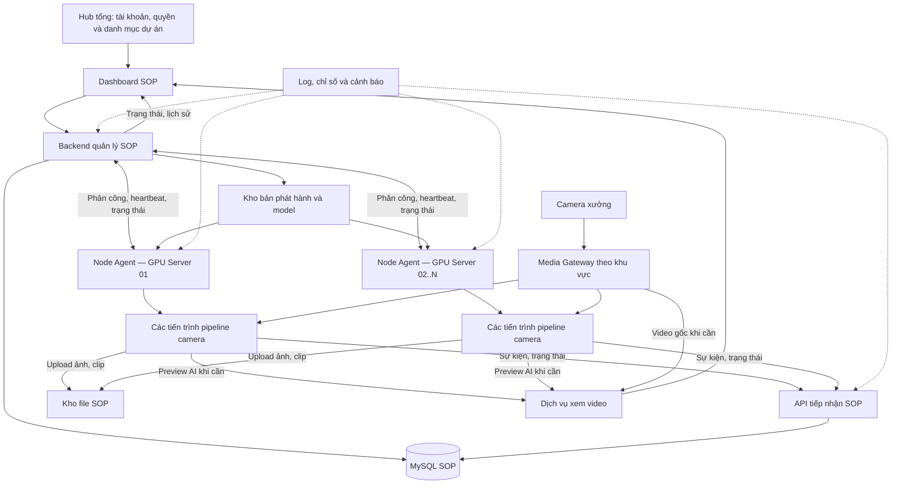

# Kế hoạch kiến trúc phân tán cho dự án AI giám sát thao tác

**Trạng thái:** kế hoạch phát triển, chưa phải hướng dẫn cài đặt các tính năng đã hoàn thiện.

Tài liệu này thay thế hướng dẫn Distributed Edge trước đây và là kế hoạch kiến trúc duy nhất cho việc mở rộng SOP. Phạm vi hiện tại là dự án giám sát thao tác. Hub tổng giữ vai trò quản lý và truy cập dự án; chưa triển khai thêm dự án AI khác.

## 1. Mục tiêu và kiến trúc được chọn

- Hub tổng cung cấp danh mục dự án, tài khoản và quyền truy cập.
- Khi chọn SOP, người dùng vào hệ thống con có backend, dashboard, dữ liệu và các node xử lý riêng.
- SOP hướng đến 100–200 camera bằng cách bổ sung server, đăng ký node và giao camera từ một nơi.
- Mỗi camera được phép có model, engine thao tác, ROI, thứ tự bước, thời gian, ngưỡng và thông số chạy riêng.
- Mỗi camera là một pipeline có ID ổn định, trạng thái nghiệp vụ và bộ phiên bản triển khai riêng.
- Phần mềm được phát hành tập trung; không copy nguyên dự án, sửa cấu hình rồi vận hành một dashboard/DB riêng trên mỗi server.
- Thêm camera, cập nhật hoặc sửa lỗi phải có phạm vi ảnh hưởng rõ ràng và khả năng quay lại phiên bản trước.
- 200 camera là mục tiêu kiểm thử năng lực, không phải cam kết hệ thống mặc nhiên đáp ứng.

**Quyết định:** backend SOP quản lý tập trung + Node Agent trên từng server + tiến trình pipeline camera + Media Gateway theo khu vực + dữ liệu và kho file dùng chung của SOP.

## 2. Đánh giá kế hoạch cũ và hiện trạng repository

| Nội dung | Mã hiện có | Quyết định |
|---|---|---|
| Hub tổng và trang SOP | `app/routes.py` có `/` và `/sop`, cùng ứng dụng Flask | Giữ cổng truy cập; tạo ranh giới backend SOP để có thể triển khai độc lập |
| Tách AI khỏi dashboard | `main.py` có `full`, `aggregator`, `is_external` | Tận dụng khi chuyển đổi; chưa phải cơ chế quản lý hay phân công server |
| Model/cấu hình từng camera | `FrameProcessor` nhận `yolo_model`, thông số camera và engine | Giữ khả năng tùy biến; quản lý bằng bản triển khai có phiên bản |
| Tái sử dụng model | `InferenceEngine` giữ instance theo đường dẫn trong cùng tiến trình, khóa theo instance | Là tối ưu nội bộ; chưa phải quản lý GPU giữa nhiều server |
| GPU | `shared/inference_engine.py` chỉ định `CPUExecutionProvider`; requirements có `onnxruntime` | Cần chọn provider, khóa môi trường và xác nhận GPU thực sự chạy trước khi đo năng lực |
| Edge Client | `edge_client/main.py` chạy một camera, có vòng xử lý/vẽ hình riêng | Tái sử dụng thành phần; hợp nhất thành một pipeline nghiệp vụ dùng chung |
| Kết quả Edge | `FramePusher` gửi JPEG/status/hands; `push_frame` lưu cache RAM, phát WebSocket | Chỉ đủ đường preview/trạng thái tạm; phải xây tiếp nhận sự kiện bền vững và lưu clip |
| Phụ thuộc DB/cấu hình | Processor local gọi `EventQueries`, các lớp đọc cấu hình toàn cục | Tách giao diện nhận cấu hình và xuất sự kiện; worker không ghi DB trực tiếp |
| Phân phối phần mềm | `edge_dist` có script đóng gói/copy | Dùng làm đầu vào cho phát hành; chưa có đăng ký node, cập nhật tập trung và rollback |

Kế hoạch cũ phù hợp thử nghiệm một camera trên một máy Edge. Nó chưa đáp ứng quản lý nhiều camera trên nhiều server, phân phối model/cấu hình, đồng bộ dữ liệu nghiệp vụ và sửa lỗi tập trung.

Loại bỏ các cam kết chưa đo: CPU Hub gần bằng 0, phần cứng mini-PC mặc định đủ chạy, số camera không giới hạn, mức CPU/độ trễ cố định và giảm băng thông theo tỷ lệ tuyệt đối. Chuyển sang aggregator không chứng minh lịch sử, thống kê và clip đã được bảo toàn.

Chi tiết cũ không khớp code: API nhận frame đọc khóa từ biến môi trường `HUB_API_KEY`; TTL cache hiện là hằng số trong `app/__init__.py`. Không coi các khóa YAML mô tả trong hướng dẫn cũ là đã được thực thi đầy đủ.

## 3. Sơ đồ hệ thống đích



Đây là các vai trò phần mềm, không yêu cầu mỗi ô là một máy. Ban đầu backend, MySQL, kho file và gateway có thể cùng server nếu đủ tài nguyên; vẫn chạy thành dịch vụ riêng, dùng địa chỉ cấu hình để tách máy sau này.

Hub tổng không chạy vòng AI hay nhận toàn bộ video. Quản trị camera, phân công và vận hành nằm trong SOP. Chưa xây đầy đủ quản lý đa dự án ở giai đoạn này, nhưng giữ ranh giới API/quyền để tích hợp sau.

## 4. Các thành phần của hệ thống SOP

### 4.1. Backend và dashboard SOP

Backend quản lý camera, khu vực, model, engine, cấu hình, deployment, node và phân công. Nó lưu riêng:

- **Mong muốn:** camera phải chạy deployment nào, trên node nào, bật hay dừng.
- **Thực tế:** node đang chạy phiên bản nào, pipeline sẵn sàng chưa, FPS và lỗi ra sao.

Dashboard cung cấp cấu hình nháp, chạy thử, kích hoạt, cập nhật, chuyển node, rollback, lịch sử và cảnh báo. Bản đầu phân công thủ công có kiểm tra năng lực; không tự chuyển camera chỉ vì mất heartbeat.

Giữ một backend SOP với các module rõ ràng trong cùng kho mã. Chưa tách mọi chức năng thành microservice.

### 4.2. Node Agent trên server GPU

Agent chạy như dịch vụ riêng, tự khởi động cùng server:

- Đăng ký bằng `node_id` và thông tin xác thực riêng, được quản trị viên duyệt.
- Báo GPU/VRAM, CPU/RAM, runtime, dung lượng, đường mạng và các pipeline đang chạy.
- Nhận phân công; tải đúng ứng dụng, model và cấu hình, kiểm tra checksum/tương thích.
- Khởi động, dừng và theo dõi tiến trình camera; restart có giới hạn, backoff và cảnh báo.
- Giữ cache artifact trên ổ local, báo kết quả triển khai và heartbeat độc lập với vòng AI.

Agent còn sống không chứng minh camera còn hoạt động. Cần theo dõi frame mới nhất, tiến độ xử lý và sức khỏe từng pipeline.

### 4.3. Pipeline camera

Chọn **một tiến trình cho mỗi camera** làm cơ sở đầu tiên để cô lập lỗi, cấu hình và vòng đời. Agent quản lý nhiều tiến trình trên cùng server. Đo overhead RAM/VRAM trước khi tăng quy mô; chỉ tối ưu nhóm camera khi có bằng chứng cần thiết và vẫn giữ quản lý độc lập từng camera.

```text
Đọc nguồn video -> decode -> chọn frame/tiền xử lý -> model camera
                -> hậu xử lý -> engine SOP + cấu hình camera
                -> trạng thái chu kỳ, sự kiện, ảnh/clip và preview
```

Model quyết định thấy đối tượng gì; engine và cấu hình quyết định thao tác đúng hay sai. Mỗi camera giữ FSM, bộ đếm, bộ đệm và trạng thái dừng riêng.

Yêu cầu khi tách pipeline:

- Nhận cấu hình đã resolve từ ngoài; tách phụ thuộc Flask, DB và việc tự đọc cấu hình toàn cục.
- Dùng cùng pipeline nghiệp vụ cho production và phát lại video; tránh hai bộ logic local/Edge.
- Gắn sequence/thời gian cho frame; không cập nhật FSM nhiều lần từ cùng frame do polling.
- Bộ đệm hữu hạn; ưu tiên frame mới cho giám sát trực tiếp. Khoảng trống frame quá mức cho phép phải báo chất lượng giám sát suy giảm.
- Thiếu model/engine/cấu hình hợp lệ phải báo lỗi, không âm thầm chạy truyền hình rồi báo AI đang hoạt động.
- Lỗi tiến trình camera không kéo dừng agent hoặc các tiến trình camera khác.

### 4.4. Media Gateway và đường xem video

Dùng MediaMTX làm nguồn RTSP chuẩn theo khu vực mạng. Khai báo nguồn camera một lần; các bên được phép dùng chung path để hạn chế kéo trùng.

- Chọn vị trí gateway dựa trên đường mạng/firewall thực tế. Không khẳng định proxy loại bỏ mọi nghẽn firewall.
- Chọn main/sub-stream theo kết quả kiểm thử độ chính xác của từng camera.
- AI đọc 24/7 thì luồng vẫn hoạt động; on-demand chỉ tiết kiệm khi không còn reader.
- Gateway nguồn không tự tạo video vẽ kết quả AI. Worker cung cấp preview đã vẽ qua dịch vụ xem; UI phân biệt video gốc và preview AI.
- Trang lưới dùng trạng thái/thumbnail có giới hạn tần suất; video chi tiết mở theo nhu cầu, có quyền và giới hạn người xem.
- Không đẩy JPEG liên tục của toàn bộ camera qua backend nghiệp vụ làm kiến trúc đích. `push_frame` chỉ dùng tạm trong chuyển đổi có đo tải.
- Chốt phiên bản MediaMTX và cấu hình tương ứng; tài liệu hiện mô tả `rtspTransport` cho nguồn RTSP. Kiểm thử codec, giao thức xem, trình duyệt và đường mạng.
- Lập phương án phục hồi gateway; một gateway duy nhất là một điểm lỗi chung.

### 4.5. Dữ liệu và kho file

Giữ MySQL hiện có làm nguồn dữ liệu chính của SOP. Worker không giữ thông tin đăng nhập DB và không ghi DB trực tiếp.

Bản đầu dùng API HTTPS để tiếp nhận sự kiện cùng hộp thư gửi bền vững trên node; chưa đưa broker phân tán vào yêu cầu triển khai. Ảnh/clip/model/bản phát hành dùng kho file SOP với API có xác thực. DB giữ metadata/object key, không coi đường dẫn local của worker là đường dẫn dùng chung.

Phân biệt dữ liệu quản lý, lịch sử nghiệp vụ, trạng thái tức thời và video. Kho file có quota, retention, giám sát dung lượng và sao lưu. Giữ artifact cần thiết cho rollback.

## 5. Mô hình dữ liệu và bản triển khai camera

Các thực thể dưới đây là phần cần xây, chưa phải các bảng hiện có:

| Thực thể | Nội dung |
|---|---|
| Camera | ID ổn định, tên máy, khu vực, nguồn và tham chiếu bí mật kết nối |
| Model artifact | ID, phiên bản bất biến, checksum, input/output/class mapping và yêu cầu runtime |
| Worker release | Phiên bản ứng dụng chứa engine, dependency khóa và checksum |
| Camera config revision | ROI, bước, timeout, ngưỡng, FPS, độ phân giải và chính sách clip |
| Deployment | Bộ worker release + model + cấu hình đã xác định cho camera |
| Node | Danh tính, phần cứng/mạng, heartbeat và khả năng nhận việc |
| Assignment | Deployment giao cho node nào, generation/quyền xử lý và trạng thái mong muốn |
| Run session | Một lần chạy pipeline, bộ phiên bản thực tế, thời gian và lý do kết thúc |
| Event/media | Chu kỳ, vi phạm, trạng thái upload, liên kết camera/session |
| Audit log | Ai thay đổi, nội dung trước/sau, thời điểm và kết quả |

Ví dụ bản triển khai đích, **không phải cấu hình chạy được của mã hiện tại**:

```yaml
camera_id: machine_07
deployment_id: machine_07-deploy-008
worker_release: sop-worker-1.4.0
engine_id: TFF4040
model_artifact: machine_07-model-v3
config_revision: machine_07-config-v8
assignment:
  node_id: gpu-node-02
  generation: 12
  desired_state: running
```

Worker resolve ID thành artifact/cấu hình đúng phiên bản, không rơi về model mặc định khi khai báo sai. Engine là code thuộc worker release; thao tác mới cần logic mới thì phát hành code mới.

Cấu hình kích hoạt là bất biến. ROI ghi hệ tọa độ, kích thước ảnh tham chiếu và phép resize/letterbox. Kiểm tra class mapping tương thích với engine; đổi model/độ phân giải cần kiểm tra lại.

## 6. Phát hành phần mềm và quy trình mở rộng

### 6.1. Cách triển khai ban đầu

Với môi trường Windows trong kế hoạch hiện tại, dùng worker đóng gói theo phiên bản bất biến; Node Agent chạy dạng Windows Service và tạo tiến trình con. Khóa dependency, kiểm tra artifact trên môi trường mục tiêu và lưu checksum. Xác nhận driver/runtime/provider GPU thực tế.

Cài mỗi phiên bản vào thư mục riêng. Agent tải vào staging, kiểm tra rồi kích hoạt; không ghi đè code hoặc môi trường đang chạy. Giữ bản trước để rollback. Cập nhật agent theo quy trình bảo trì riêng, từng node, có phương án quay lại.

Chưa bắt buộc Kubernetes hoặc suy luận model tập trung. Ranh giới agent/artifact/API cho phép đổi cách đóng gói sau này mà không đổi ID camera và hợp đồng dữ liệu.

### 6.2. Thêm server xử lý

1. Chuẩn bị OS, driver/runtime, đồng bộ giờ và kết nối gateway/backend/kho file.
2. Cài agent một lần, đăng ký vào SOP và được duyệt.
3. Kiểm tra khả năng kết nối, runtime và chạy một camera thử.
4. Quản trị viên giao camera trên dashboard; agent tải bộ triển khai rồi chạy.
5. Chỉ báo thành công khi đúng phiên bản, có frame mới và kết quả hợp lệ.

Server 02 cần phần mềm thực thi nhưng không cần dashboard, DB hoặc cấu hình toàn dự án riêng. Phần mềm được lấy từ kho phát hành, không copy rồi sửa dự án thủ công.

### 6.3. Thêm camera

1. Tạo ID ổn định, khai báo nguồn ở gateway phù hợp.
2. Đăng ký model, chọn engine, tạo cấu hình nháp và hiệu chỉnh ROI.
3. Kiểm tra schema, class mapping và phát lại video mẫu.
4. Chọn node dựa trên kết nối nguồn, runtime và năng lực đã đo.
5. Chạy thử tách khỏi thống kê production; kiểm tra hình, SOP, sự kiện và clip.
6. Kích hoạt deployment, kiểm tra lịch sử/dashboard và ghi audit.

Nếu cần engine mới, phát hành worker mới; camera khác tiếp tục ghim release hiện có cho đến khi được chọn cập nhật.

### 6.4. Chuyển camera khi server gần đầy

Không chờ CPU/GPU đạt 100%. Cảnh báo theo tải và độ trễ đã đo; bản đầu chuyển có kiểm soát:

1. Node đích tải artifact, kiểm tra năng lực nhưng chưa chạy production.
2. Pipeline nguồn dừng ở ranh giới chu kỳ nếu có thể; ghi nhận dữ liệu còn chờ.
3. Xác nhận nguồn đã dừng, thu hồi assignment cũ, tăng generation và cấp quyền cho node đích.
4. Node đích tạo run session mới; ID camera và lịch sử giữ nguyên.
5. Nếu bắt buộc ngắt giữa chu kỳ, ghi `monitoring_gap`, đánh dấu chu kỳ gián đoạn và khởi tạo FSM mới.

Bản đầu không cam kết khôi phục giữa chu kỳ. Không cấp quyền mới chỉ vì mất heartbeat mà chưa xác nhận dừng hoặc hết quyền cũ.

## 7. Quyền xử lý, cập nhật và phục hồi

### 7.1. Quyền sở hữu camera

- Assignment có generation tăng đơn điệu và lease hữu hạn, gia hạn qua backend.
- Agent dùng thời gian monotonic để theo dõi hạn lease, dừng quyền chạy production khi hết hạn.
- Backend chỉ cấp assignment thay thế sau xác nhận dừng hoặc lease cũ hết hiệu lực, có khoảng an toàn cho truyền/nhận và xử lý.
- Tiếp nhận dữ liệu phải kiểm tra node, camera, run session và generation; không tin riêng camera ID.
- Khi backend mất liên lạc, pipeline tiếp tục bằng cấu hình đã xác nhận trong thời hạn lease còn hiệu lực và lưu tạm sự kiện. Hết lease tạo gián đoạn giám sát. Đây là đánh đổi có chủ đích để tránh hai bên cùng sở hữu camera.
- Bản đầu không tự failover. Chỉ bổ sung sau khi kiểm thử lease, ngắt mạng, node cũ quay lại và năng lực dự phòng.

### 7.2. Cập nhật và rollback

Thay đổi tạo deployment mới. Kiểm thử phát lại video, triển khai thử vài camera rồi mở rộng. Chuyển bản tại ranh giới chu kỳ hoặc dừng có ghi gián đoạn; không ghép âm thầm trạng thái của hai phiên bản.

Rollback đúng bộ release + model + cấu hình đã chạy ổn định. Migration DB phải tương thích các phiên bản cùng tồn tại trong đợt cập nhật và có phương án khôi phục.

## 8. Hợp đồng giao tiếp và bảo toàn dữ liệu

Các nhóm giao tiếp cần xây; tên endpoint chốt khi triển khai, chưa coi là API đang tồn tại:

| Nhóm | Dữ liệu/hành vi |
|---|---|
| Đăng ký node | Danh tính, năng lực, duyệt và thu hồi |
| Heartbeat | Tài nguyên, run session, lỗi và thời điểm frame mới nhất |
| Assignment | Desired state, deployment, generation/lease và ACK triển khai |
| Artifact | Manifest, checksum, tải có xác thực và kiểm tra tương thích |
| Trạng thái camera | Snapshot FSM, FPS, độ trễ, tình trạng nguồn/model/pipeline |
| Sự kiện | ID duy nhất, camera/session, sequence, thời gian và bộ phiên bản |
| Media | Upload/retry, checksum, trạng thái pending/ready/failed và liên kết sự kiện |

### 8.1. Sự kiện

- Pipeline ghi sự kiện vào hộp thư local bền vững; gửi mạng ở luồng/tiến trình riêng để không chặn AI.
- Tạo ID sự kiện trước khi gửi; backend chỉ ACK sau transaction DB commit, dùng ràng buộc duy nhất chống trùng.
- Gửi lại có backoff: ít nhất một lần gửi, không tuyên bố truyền đúng một lần trên mạng.
- Sequence theo run session giúp phát hiện thiếu/đảo thứ tự; không dùng thứ tự HTTP đến làm thứ tự thao tác.
- Sự kiện lịch sử gửi muộn đối chiếu session/assignment trước đó; không loại bỏ tất cả chỉ vì generation hiện tại đã đổi.
- Dữ liệu không xác minh được quyền xử lý phải giữ riêng để đối soát, không âm thầm ghi vào thống kê hoặc xóa bỏ.
- Lưu thời gian sự kiện và thời gian tiếp nhận riêng, giám sát lệch đồng hồ.

### 8.2. Media và giới hạn local

Worker giữ ảnh/clip tạm, upload với checksum và liên kết theo ID sự kiện. Sự kiện có thể có trước clip; UI hiển thị pending/failed rõ ràng. Không xóa file local trước khi xác nhận upload theo chính sách.

Hộp thư và file tạm có giới hạn dung lượng, cảnh báo trước khi đầy. Khi vượt giới hạn, báo thiếu dữ liệu/bằng chứng và tình trạng suy giảm; không báo khỏe.

### 8.3. Cache và nhân bản backend

`external_frames` hiện là bộ nhớ riêng từng tiến trình. Không thể tăng số Flask worker hoặc thêm backend rồi mặc nhiên coi cache/trạng thái đã chia sẻ.

Trước khi nhân bản backend phải triển khai trạng thái dùng chung, phân phối sự kiện realtime giữa các instance, đường media độc lập và kiểm thử reconnect của trình duyệt.

## 9. Giám sát và sửa lỗi

| Mức theo dõi | Nội dung |
|---|---|
| Toàn SOP | Camera running/degraded/offline, sự kiện tồn, upload lỗi, DB/kho file và tải tổng |
| Node | CPU/RAM/GPU/VRAM, decode, ổ local, mạng, heartbeat, restart và pipeline |
| Camera | FPS nguồn/xử lý, tuổi frame, độ trễ, FSM, bộ phiên bản thực tế, lỗi cuối và lịch sử chuyển node |

Phân biệt mất camera, lỗi decode, model load lỗi, AI chậm, lỗi SOP, mất backend và lỗi lưu clip. Log gắn `project_id`, `camera_id`, `node_id`, `run_session_id`, `deployment_id` và event ID khi có. Không ghi bí mật kết nối.

Thu log/chỉ số tập trung, có retention và cảnh báo. Phát hiện pipeline đứng dù tiến trình còn sống.

Công cụ phát lại dùng đúng video, bộ phiên bản và pipeline production; dữ liệu thử nghiệm tách khỏi dữ liệu thật. Giữ tập video kiểm chứng theo từng thao tác để đánh giá bỏ sót, cảnh báo sai, thứ tự bước và độ trễ trước mỗi thay đổi.

## 10. Năng lực, dự phòng và phân quyền

- Đo số model khác nhau, VRAM thường trú, CPU decode, RAM bộ đệm clip, FPS, độ trễ p95/p99, mạng, lưu trữ và tải người xem.
- Đo cả lúc khởi động model, reconnect và gửi bù dữ liệu. Không suy ra sức chứa từ GPU utilization trung bình hoặc số camera đơn thuần.
- “20 camera/server” chỉ là năng lực của bộ model/thông số đã kiểm thử. Ví dụ 200/20 = 10 server là danh nghĩa; muốn chịu lỗi một server phải có năng lực dự phòng đã đo.
- Backend, DB, gateway và kho file cũng có giới hạn/điểm lỗi. Định nghĩa mức gián đoạn và mất dữ liệu chấp nhận được, kiểm thử backup/restore.
- Trước khi mở rộng lớn phải chuẩn bị dự phòng các thành phần trung tâm phù hợp yêu cầu vận hành; thêm GPU không tạo dự phòng cho backend/DB.
- Phân quyền xem, cấu hình và triển khai riêng; ghi audit. Node có khóa riêng và phạm vi camera được giao, thu hồi độc lập.
- Bí mật camera không nằm trong YAML chia sẻ/artifact; dùng kênh mã hóa giữa server, hạn chế đường mạng đến DB và camera.

## 11. Lộ trình triển khai duy nhất

Đây là các mốc của cùng kiến trúc, không duy trì dài hạn hai nhánh nghiệp vụ local và Edge.

| Mốc | Công việc | Điều kiện hoàn thành |
|---|---|---|
| 1. Chuẩn hóa pipeline | Tách cấu hình/output khỏi Flask/DB; giao diện engine, deployment, runner phát lại và provider GPU | Camera dùng model/config riêng; kết quả và clip tương đương baseline; xác nhận provider thực tế |
| 2. Dữ liệu bền vững | API sự kiện, hộp thư local, chống trùng, upload media, snapshot trạng thái | Mất mạng rồi gửi lại không mất/trùng trong cửa sổ lưu cấu hình; lịch sử/thống kê/clip đúng |
| 3. Agent và phát hành | Đăng ký node, giám sát tiến trình, manifest/checksum, staging, heartbeat và rollback | Hai server nhận cùng bản phát hành và chạy camera được giao mà không copy/sửa nguyên dự án |
| 4. Quản lý tập trung | UI node/camera, cấu hình nháp, desired/actual, assignment, generation/lease và audit | Thêm/chuyển camera giữa hai server; update/rollback đúng bản; ngắt mạng không tạo hai nguồn kết quả production hợp lệ |
| 5. Vận hành và video | Gateway theo khu vực, preview theo nhu cầu, log/chỉ số/cảnh báo, backup/restore và dự phòng trung tâm | Đạt chỉ tiêu độ chính xác/độ trễ/tài nguyên đã chốt; tìm được lỗi và phục hồi được |
| 6. Mở rộng có đo | Tăng từ cụm nhỏ đến 20, 50, 100 và 200 camera mục tiêu; đo người xem thực tế | Mỗi mức vượt qua chạy kéo dài và thử lỗi trước khi tăng; có dự phòng phù hợp |

Trong chuyển đổi, di chuyển từng camera và giữ hệ thống hiện tại phục vụ phần còn lại. Một camera chỉ có một bên được phép ghi sự kiện production; chạy đối chiếu phải tách dữ liệu thử nghiệm.

## 12. Checklist nghiệm thu

- [ ] Từ Hub tổng vào SOP; quản lý node/camera thuộc SOP, có quyền và audit.
- [ ] Ít nhất hai server xử lý, một dashboard và lịch sử chung.
- [ ] Camera dùng đúng model/engine/cấu hình riêng, không âm thầm dùng mặc định.
- [ ] Thêm server bằng cài agent, đăng ký, duyệt và nhận việc.
- [ ] Cập nhật một camera không restart toàn server; lỗi một tiến trình không kéo dừng camera khác.
- [ ] Chuyển node/cập nhật giữa chu kỳ có quy tắc; không tính chu kỳ gián đoạn là đạt.
- [ ] Mất heartbeat/backend và node cũ quay lại không gây ghi nhận kép.
- [ ] ACK sau commit; gửi lại không trùng; sự kiện muộn/thiếu sequence được xử lý rõ.
- [ ] Clip pending/upload lỗi, ổ đầy và không có frame mới đều được báo đúng.
- [ ] Phát lại tái hiện lỗi theo bộ phiên bản; rollback và restore DB/file được thử.
- [ ] Năng lực phần cứng, độ chính xác, độ trễ, mạng, lưu trữ và người xem được đo.

## 13. Nguồn đối chiếu

- Mã hiện tại: `main.py`, `app/routes.py`, `app/__init__.py`, `projects/sop_monitoring/processor.py`, `projects/sop_monitoring/hand_detector.py`, `projects/sop_monitoring/core/engines/loader.py`, `shared/inference_engine.py`, `edge_client/main.py`, `edge_client/frame_pusher.py`, `requirements.txt`, `edge_dist/`.
- [MediaMTX: cấu hình](https://mediamtx.org/docs/references/configuration-file) và [xem trên trình duyệt](https://mediamtx.org/docs/read/web-browsers).
- [ONNX Runtime: CUDA Execution Provider](https://onnxruntime.ai/docs/execution-providers/CUDA-ExecutionProvider.html), khi phần cứng NVIDIA và môi trường tương thích.

Các thực thể, API và tiêu chí trên là phần cần triển khai theo lộ trình. Cập nhật tài liệu không thay đổi mã chạy và không có nghĩa hệ thống hiện tại đã đạt các tiêu chí nghiệm thu.
