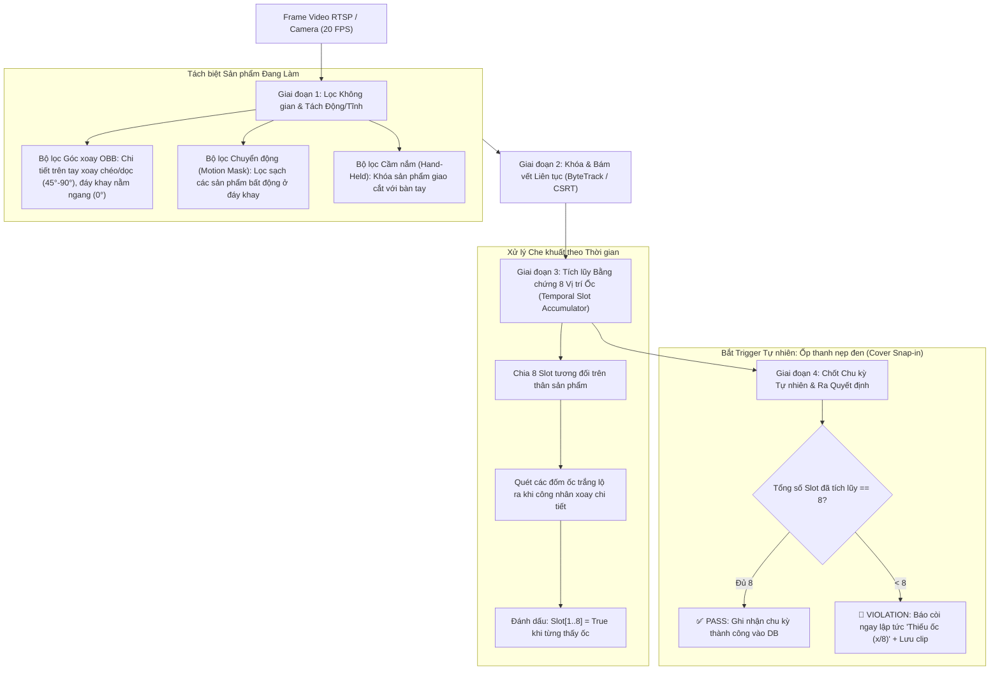

# KẾ HOẠCH TRIỂN KHAI HỆ THỐNG AI GIÁM SÁT LẮP RÁP 8 CON ỐC TRẮNG (TRẠM LẮP RÁP)

> **Mã nguồn áp dụng:** `AI_Monitoring_Hub`  
> **Camera / Dữ liệu kiểm thử:** `data/recordings/laprap_20261103_131237_10min.mp4` (Máy 8)  
> **Mục tiêu cốt lõi:** Tự động phát hiện và đảm bảo công nhân **lắp đủ 8 con ốc trắng vào sản phẩm màu đen** trong điều kiện **thao tác hoàn toàn tự do, không can thiệp vào quy trình của công nhân**.

---

## 1. Bối cảnh & Thách thức Kỹ thuật Thực tế

Qua khảo sát toàn bộ video 9 phút ghi hình thực tế tại trạm, hệ thống phải giải quyết 4 thách thức lớn mà mô hình FSM cũ (của các máy dập `TFF4040`, `626287`) không xử lý được:

1. **Thao tác phi cấu trúc (Unconstrained Manipulation):** Công nhân xoay chi tiết 3D tự do (nghiêng, dựng đứng, dốc ngược), không có thứ tự gắn ốc cố định, có thể bốc 1 lần 2–3 con ốc.
2. **Nhiều sản phẩm trong khung hình (Multi-object Clutter):** Tại cùng một thời điểm, có sản phẩm nằm dưới đáy khay 5 ngăn, có sản phẩm người bên cạnh cầm, và sản phẩm công nhân đang thao tác.
3. **Thao tác lơ lửng ngay trên bề mặt khay (Spatial Overlap):** Khi nhấc sản phẩm lên lắp, tay công nhân để lơ lửng ngay phía trên khay, khiến góc nhìn 2D từ camera bị chồng lấn trực tiếp lên các sản phẩm đang nằm dưới đáy khay.
4. **Nhiễu bao ngón tay trắng:** Công nhân đeo bao ngón tay cao su màu trắng, dễ gây nhầm lẫn với hạt ốc nếu thuật toán chỉ dựa vào màu sắc đơn thuần.

---

## 2. Kiến trúc Giải pháp (4 Giai đoạn)

---

## 3. Chi tiết Giải pháp Kỹ thuật

### 3.1. Phân biệt Sản phẩm Đang Thao tác vs. Sản phẩm Dưới Khay
- **Bộ lọc Góc xoay (Oriented Bounding Box - OBB):**
  - Chi tiết dưới đáy khay: Bắt buộc nằm ngang theo rãnh ($\text{Góc} \approx 0^\circ$).
  - Chi tiết đang nhấc trên tay: Luôn xoay dọc ($90^\circ$) hoặc nghiêng chéo ($45^\circ - 60^\circ$) để ấn ốc.
  - Bất kỳ Bbox nào có góc lệch $> 30^\circ$ được định danh ngay là sản phẩm trên tay.
- **Bộ lọc Chuyển động (Motion Foreground Mask):**
  - Dùng Background Subtraction (MOG2) để tách phần động khỏi nền. Sản phẩm dưới rãnh khay đứng yên ($v=0$) sẽ bị xóa sạch, chỉ giữ lại sản phẩm đang chuyển động cùng bàn tay ($v > 0$).
- **Khóa Tracker từ thời điểm nhấc phôi (Origin Locking):**
  - Bắt thời điểm tay nhấc phôi ra khỏi rãnh khay $\rightarrow$ Gán `Target_ID` và dùng ByteTrack bám vết liên tục với chu kỳ 50ms, triệt tiêu nguy cơ nhảy ID xuống đáy khay.

### 3.2. Thuật toán Tích lũy Bằng chứng 8 Vị trí Ốc (Temporal Slot Accumulator)
- Thân sản phẩm được chia thành **8 vị trí hình học cục bộ (8 Slots)**:
  - Cụm đỉnh: Slot 1, Slot 2.
  - Cụm giữa: Slot 3, Slot 4, Slot 5, Slot 6.
  - Cụm đáy: Slot 7, Slot 8.
- Trong suốt 30–50 giây lắp ráp:
  - Không cần tìm một frame nhìn thấy cùng lúc cả 8 ốc.
  - Khi công nhân xoay chi tiết, từng cụm lộ ra trước camera $\rightarrow$ Hệ thống tự động kích hoạt `Slot[i] = True`.
  - Bộ tích lũy giữ trạng thái này cho đến hết chu kỳ.

### 3.3. Bắt Thời điểm Kết thúc Chu kỳ Tự nhiên (Natural Trigger)
- Không bắt công nhân dừng lại giơ lên trước camera.
- Sử dụng **thao tác ốp thanh nẹp đen (slider cover)** từ khay bên trái vào thân chi tiết làm **Trigger chốt chu kỳ**.
- Tại thời điểm phát hiện hành vi ốp nẹp:
  - Đóng bộ tích lũy.
  - Đánh giá: Nếu $\sum_{i=1}^8 \text{Slot}[i] == 8 \rightarrow$ Hợp lệ.
  - Nếu thiếu ốc $\rightarrow$ Kích hoạt cảnh báo âm thanh trước khi sản phẩm bị đưa đi.

---

## 4. Kế hoạch Triển khai theo Giai đoạn (Timeline & Milestones)

| Giai đoạn | Nội dung công việc | Thời gian dự kiến | Kết quả đầu ra (Deliverables) |
| :--- | :--- | :---: | :--- |
| **Giai đoạn 1** | **PoC Offline & Trích xuất dữ liệu mẫu** - Cắt 100–150 frame đại diện từ video 9 phút. - Gán nhãn mẫu cho: `part_hand` (thân trên tay), `part_tray` (thân dưới khay), `white_screw` (ốc trắng), `cover` (thanh nẹp). | 2 ngày | Bộ dataset chuẩn + Script kiểm chứng bóc tách sản phẩm trên tay. |
| **Giai đoạn 2** | **Huấn luyện Mô hình AI Chuyên dụng** - Huấn luyện YOLOv11-OBB / YOLOv11-nano gọn nhẹ tối ưu CPU. - Xuất model sang định dạng ONNX chạy trực tiếp với `InferenceEngine` hiện có. | 2–3 ngày | Model `laprap_v2.onnx` đạt mAP50 $> 95\%$ cho ốc và thân sản phẩm. |
| **Giai đoạn 3** | **Xây dựng Engine `laprap_engine_v2.py`** - Viết module kế thừa `BaseEngine`. - Tích hợp bộ lọc OBB, Motion Mask và Temporal Slot Accumulator. - Tích hợp trigger ốp nẹp và logic cảnh báo còi âm thanh. | 3 ngày | File `laprap_engine_v2.py` hoàn chỉnh trong thư mục `core/engines/`. |
| **Giai đoạn 4** | **Kiểm thử trên Video 9 phút & Tinh chỉnh** - Chạy toàn bộ video 9 phút qua `processor.py`. - Đối soát số lượng chu kỳ hoàn thành, số sản phẩm đạt, và phát hiện các tình huống bất thường. | 2 ngày | Báo cáo kiểm thử đạt độ chính xác $> 95\%$, không báo động giả. |

---

## 5. Tiêu chuẩn Đánh giá Hoàn thành (Acceptance Criteria / KPIs)

1. **Độ chính xác đếm ốc:** Phát hiện đúng sản phẩm đủ 8 ốc đạt $\ge 98\%$.
2. **Bắt lỗi thiếu ốc (Zero-Defect Leakage):** Bắt được $100\%$ các trường hợp thiếu từ 1 đến 2 con ốc trước khi công nhân ốp nắp nẹp.
3. **Tách biệt sản phẩm:** Tỷ lệ nhầm lẫn giữa sản phẩm trên tay và sản phẩm dưới khay bằng $0\%$.
4. **Hiệu năng hệ thống:** Thời gian xử lý inference trên CPU $\le 60\text{ms/frame}$ (đáp ứng trơn tru tốc độ 15–20 FPS của luồng RTSP).

---

## 6. Các Quyết định Kỹ thuật Cần Xác nhận

1. **Âm thanh cảnh báo tại chỗ:** Khi phát hiện thiếu ốc, trạm sẽ phát còi qua loa nối máy tính trạm (`AudioAlert` hiện có trong hub). Cần xác nhận trạm Máy 8 đã có sẵn loa ngoài chưa?
2. **Quy định đối với sản phẩm bị đưa đi mà chưa ốp nẹp:** Nếu công nhân chưa ốp nẹp mà đã đưa thẳng sang thùng khác, hệ thống sẽ đánh dấu là chu kỳ lỗi (Incomplete SOP). Quy trình thực tế có cho phép điều này không?

